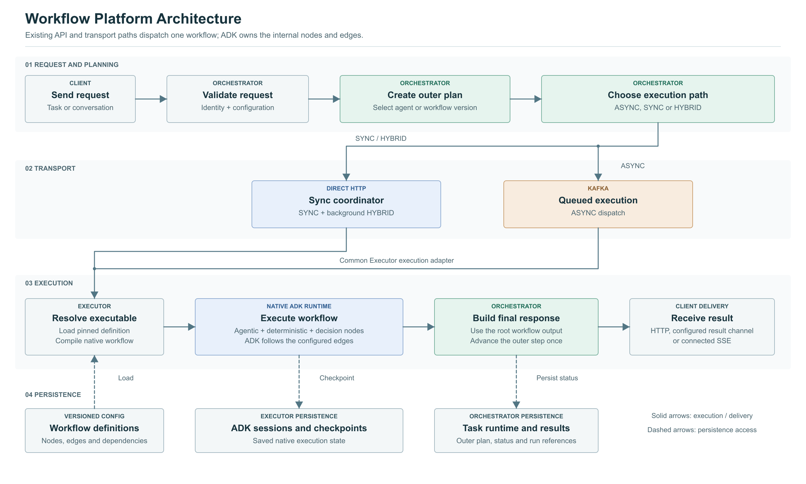
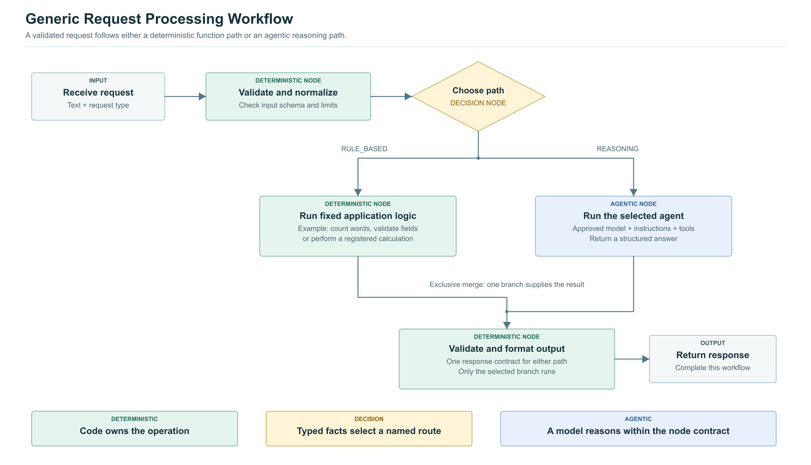
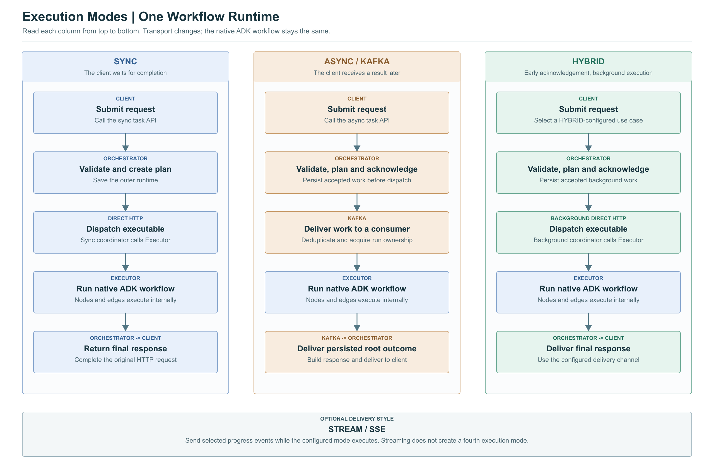

# ADK 2.x Workflow Architecture and Implementation

**Updated:** 23 October 2026  
**Status:** Proposed application architecture  
**Services:** Agentic Orchestrator and Agent Executor  
**Scope:** Automatic request processing using agentic, deterministic, and decision nodes  
**Library assumption:** The existing libraries already support ADK 2.x.

This revision uses a general request-processing example throughout. The diagrams, JSON definition, Python example, and implementation phases describe the same architecture and node types.

## 1. Recommended Architecture

Keep the Orchestrator responsible for the client request, configuration, planning, execution-mode selection, outer task status, and final delivery. Run the internal workflow graph inside the Executor using native ADK nodes and edges.

A workflow is one executable step in the existing outer plan. That step can contain several internal nodes. The existing coordinator advances outer plan steps. ADK schedules and traverses the nodes inside a workflow step.

This separation gives the application explicit workflows while retaining its current Kafka, direct HTTP, hybrid, and stream delivery paths. There should be one owner of each scheduling level.



Read the diagram in numbered bands. Request and response chains run left to right. Transport selection and execution handoff run downward. Dashed connectors show persistence access. The Executor and Orchestrator boxes are logical stages inside the existing services, not proposed new independently deployed services.

## 2. Current-Flow Basis

The current-flow description comes from the supplied Orchestrator/Executor documents and prior implementation reports. The upgraded repositories are not available in this workspace, so exact current branches, planner classes, and wrapper signatures still require verification during implementation.

| Material | Relevant information |
|---|---|
| `confluence-sync-async-hybrid-flow.md` | Authentication, configuration, planner invocation, runtime, HTTP coordination, and Kafka execution |
| `sync-task-executor-to-resume-flow.md` | Outer step fields, runtime persistence, and direct executor contract |
| `stream-api-proposed-architecture.md` | SSE event sink, streaming delivery, and the later description of background direct hybrid execution |
| Official ADK documentation and tagged source | Native workflows, node wrappers, routes, joins, structured data, retry, and recovery |

The older flow document leaves hybrid dispatch partly open. The later stream design describes hybrid as background execution through the direct HTTP coordinator. This proposal follows the later description. Confirm the deployed dispatcher before changing code.

New configuration fields, models, storage objects, event names, and module names below are proposed application contracts. Existing names are identified where the supplied material establishes them.

## 3. Existing Request and Agent Plan Flow

The current platform has an outer task lifecycle:

1. A client submits context and required identity/configuration headers.
2. The Orchestrator validates authentication and derives the trusted consumer identity.
3. Configuration loading resolves the use case, Orchestrator metadata, database routing, planner metadata, and configured agent capabilities.
4. Guardrails and execution-mode eligibility checks run.
5. The selected planner creates the outer plan and initial runtime state.
6. The platform persists the runtime before dispatch.
7. Kafka or the direct HTTP coordinator dispatches the next outer step.
8. The Executor constructs and runs the selected agent for that step.
9. The updated outer runtime is returned or published.
10. The Orchestrator advances the outer plan or finalizes the task.

The supplied material identifies outer runtime fields such as `plan.steps`, `current_step`, `next_agent`, `execution_mode`, `session_id`, and correlation/application/user identifiers.

Both static planning and dynamic sub-agent selection are mentioned. Locate their actual factories and output models in the upgraded branches before editing. Do not assume every plan is produced by a model.

### Execution mode and delivery

| Mode/style | Start API from supplied material | After planning |
|---|---|---|
| ASYNC | `/task-executor` and the normal conversational family | Kafka dispatch to workers; result delivered later |
| SYNC | `/sync/task-executor/` | Coordinator waits on direct Executor HTTP calls |
| HYBRID | Normal task route with configured `HYBRID` mode | Early acknowledgement followed by background direct coordination in the later design |
| STREAM / SSE | Proposed stream API family; verify deployed routes | Selected progress and final events delivered while the configured mode runs |

`orchestrator_config.metadata.mode` is the configured mode field in the supplied flow. The explicit sync task route forces `SYNC`. Streaming is a delivery style, rather than a fourth execution-mode enum value.

Python's asynchronous Runner API is another independent concern. Using `runner.run_async(...)` in a synchronous HTTP request does not turn that task into Kafka execution.

## 4. What Workflows Add

| Area | Current agent-step model | Workflow-enabled model |
|---|---|---|
| Outer executable | Selected agent | Selected agent or published workflow |
| Internal control | Agent instructions and tools | Explicit nodes and edges |
| Deterministic work | Often reached through agent tools | Direct registered code/service nodes |
| Branching | Planner choice or reasoning inside an agent | Named routes from decision nodes |
| Parallel work | Agent-specific behavior | Native graph branches and explicit joins |
| Progress | Outer step/agent | Outer step plus internal node progress |
| Completion | Selected agent completes its step | Root workflow completes its step |
| Recovery | Saved outer runtime | Saved outer runtime plus durable native session/invocation |
| Reuse | Agent configuration | Agent configuration plus versioned workflow definitions and function registry |

The application needs workflow definitions, validation, publication, and an ADK adapter. It does not need a second graph execution engine.

## 5. The Three Node Categories

### 5.1 Agentic node

An agentic node delegates one bounded reasoning task to a configured agent. It reuses existing model adapters, instructions, tools, guardrails, and observability.

Examples include summarizing the request text, classifying a request into an allowed enum, extracting typed fields from text, or selecting a recommendation from supplied facts.

Every agentic node should declare an input schema, an output schema, an agent configuration reference, execution limits, and a stable node name. Use explicit `mode="single_turn"` for the initial static graph examples.

A child agent finishing is a node-level event. The platform must not interpret it as completion of the outer task while other workflow nodes remain.

### 5.2 Deterministic node

A deterministic node runs registered application code without requiring a model to choose or perform that operation.

Examples include validating input, normalizing identifiers, calculating a value, counting words, reading a configured service, or formatting a response.

Use dependency injection for service clients and trusted identity. A graph input must not be able to override the tenant, user, database schema, credentials, or implementation binding.

The operation is fixed code, but its inputs or an external read may still vary over time. Preserve the relevant snapshot/version when recovery must reuse the same facts.

### 5.3 Decision node

A decision node examines typed input and emits an allowed route label. It controls which outgoing edge is followed.

For the generic example:

```text
request_type = RULE_BASED -> run the deterministic function
request_type = REASONING  -> run the selected agent
```

The decision validates allowed values and preserves the input for the selected successor. Missing or unknown values produce a controlled validation failure rather than silently ending a branch.

If a model classifies an ambiguous request, separate the classification from execution policy: `classification agent -> schema validation -> decision node`. This keeps routing inspectable and testable.

## 6. Native ADK Mapping

| Application concept | Native Python ADK building block | Application work |
|---|---|---|
| Agentic node | `Agent` / `LlmAgent`, optionally wrapped with `node(...)` | Resolve the existing agent configuration and schemas |
| Deterministic node | Callable, `FunctionNode`, or `@node` | Bind a registered function and dependencies |
| Decision node | Function returning `Event(route=..., output=...)` | Validate route labels and define fallback/error behavior |
| Sequence | Tuples in `Workflow(edges=[...])` | Resolve stable node IDs to native objects |
| Branch | Route-to-node mapping | Check route coverage and exclusivity |
| Parallel fork | Multiple outgoing native paths | Define input sharing and resource limits |
| Join | `JoinNode` | Ensure every required predecessor runs and emits output |
| Nested workflow | Another native `Workflow` | Pin versions and namespace node identity |
| Retry/deadline | `RetryConfig` and node `timeout` | Classify transient failures and align budgets |
| Dynamic composition | `@node` and `ctx.run_node(...)` | Keep code and replay behavior versioned |

Native graph workflows, their construction, and their data flow are documented in the official [graph overview](https://adk.dev/graphs/), [routing guide](https://adk.dev/graphs/routes/), and [data guide](https://adk.dev/graphs/data-handling/).

The tagged Python 2.0.0 implementation rejects task-mode agents as static graph nodes. Later releases may differ. Verify the installed wrapper and native release rather than relying on a default or on documentation for a newer release. The example explicitly uses single-turn agents. [Tagged workflow implementation](https://github.com/google/adk-python/blob/v2.0.0/src/google/adk/workflow/_workflow.py)

## 7. Generic Request-Processing Example

The example accepts a bounded text request and a declared request type. It validates the payload, selects a branch, executes either fixed code or one agent, and formats the result into a shared response contract.



The two branches are alternatives. Only the selected branch executes. They converge through an ordinary formatting node, not a join-all barrier. A join-all node here would wait for a branch that was never selected.

### Request examples

Deterministic path:

```json
{
  "request_type": "RULE_BASED",
  "text": "Count the words in this request"
}
```

Agentic path:

```json
{
  "request_type": "REASONING",
  "text": "Summarize this explanation in two sentences: ..."
}
```

The input API can infer a request type through an earlier configured classifier in a future workflow. This first example keeps the choice explicit so branch behavior can be tested independently of model behavior.

### Native edge construction

```python
root_agent = Workflow(
    name="generic_request_processing_v1",
    edges=[
        ("START", normalize, route),
        (route, {"RULE_BASED": rules, "REASONING": agent}),
        (rules, respond),
        (agent, respond),
    ],
)
```

The full [Python example](examples/native_workflow_example.py) includes strict schemas, a word-count function, the agent definition, and output formatting. It accepts an injected model and runs inside the platform's existing App/Runner setup.

### Result shape

```json
{
  "answer": "The request contains 6 words.",
  "processing_type": "RULE_BASED",
  "data": {"word_count": 6}
}
```

This is the example workflow's internal output envelope. The existing final response builder maps it to the current public response contract.

## 8. Workflow Definition and Publication

### Proposed application definition

Store a workflow as a versioned definition containing nodes, edges, implementation references, schemas, and resource policies. The full companion [JSON definition](examples/workflow-definition.json) matches the Python example.

```json
{
  "schema_version": "1.0",
  "workflow_id": "generic.request_processing",
  "version": "1.0.0",
  "entry_node_id": "normalize",
  "output_node_ids": ["respond"],
  "nodes": [
    {"id": "normalize", "kind": "deterministic", "implementation_ref": "requests.normalize.v1"},
    {"id": "route", "kind": "decision", "implementation_ref": "requests.route.v1"},
    {"id": "rules", "kind": "deterministic", "implementation_ref": "requests.count_words.v1"},
    {"id": "agent", "kind": "agentic", "agent_ref": "generic.request_agent.v1"},
    {"id": "respond", "kind": "deterministic", "implementation_ref": "requests.respond.v1"}
  ]
}
```

This excerpt omits edges and detailed policies for readability; the companion file is complete. This format is a proposed application contract, not Google's native YAML/JSON schema. Its parser and compiler must be implemented.

### Function and agent registries

Definitions should contain stable references. A trusted registry maps those references to implementation factories and configured agents. Do not load Python source, arbitrary import paths, SQL, or unrestricted expressions from an agent-generated plan.

Bind node IDs independently from implementation references. The same function may be used in two nodes with different IDs and inputs. Node identity must remain stable across recovery.

### Immutable publication

Publish an exact definition version with a canonical hash and dependency manifest. Pin agent configuration, function implementation, schema, nested-workflow, and compiler versions as applicable.

Cache immutable definitions or factories, not mutable per-run agent objects. A new run constructs its own appropriate native object graph. Concurrent runs must not share mutable execution state.

## 9. Compiler and Graph Validation

The compiler translates the application definition into a native ADK `Workflow`; it does not schedule the nodes itself.

1. Parse the versioned application schema.
2. Resolve tenant/use-case authorization for the selected published workflow.
3. Load the exact implementation, agent, and schema versions.
4. Verify graph structure and resource policies.
5. Instantiate the native functions, agents, joins, and nested roots.
6. Resolve edges and insert explicit registered data-mapping nodes where needed.
7. Construct the native workflow and run its native validation.
8. Save the immutable definition/dependency identity in the outer runtime before dispatch.

Application validation must reject duplicate IDs, unresolved references, unreachable nodes, missing terminal paths, incomplete decision labels, incompatible schemas, invalid joins, and unrestricted cycles.

The initial release should support DAGs with sequence and exclusive branches. Add parallel joins after their error/recovery behavior is covered. Add bounded loops only after per-visit identity and replay tests pass.

### Edge behavior

| Pattern | Required behavior |
|---|---|
| Sequence | Successful output becomes the successor's input |
| Exclusive branch | One named route selects one successor |
| Parallel fork | Every configured branch executes with its intended input |
| Join-all | Continue after all required predecessor outputs exist |
| Exclusive merge | Continue from the one selected predecessor |
| Bounded loop | Explicit exit, iteration budget, and distinct visit identity |
| Nested workflow | Parent waits for the child root outcome |

An operational exception must not be mistaken for an expected business route. For example, a service outage is not equivalent to a successful no-data response.

## 10. Changes to Agent Plan Creation

### Preserve legacy plans

Add a typed executable reference to outer plan steps. Existing steps without the new discriminator continue to mean the existing agent behavior.

```json
{
  "plan_schema_version": "2.0",
  "steps": [
    {
      "step_id": "process_request",
      "executable_type": "WORKFLOW",
      "workflow_ref": {
        "workflow_id": "generic.request_processing",
        "version": "1.0.0",
        "definition_hash": "sha256:<canonical-hash>"
      }
    }
  ]
}
```

`current_step` remains the index of an outer plan step. It must not become the index of an internal workflow node. Parallel graphs do not have one universally correct current-node index.

If `next_agent` is mandatory today, retain it for legacy steps and introduce a typed `next_executable` for v2 steps. Update all readers and writers together. Putting a workflow ID into `next_agent` without updating its consumers creates an ambiguous contract.

### Fixed workflow selection

After existing request validation, configuration, and guardrails, resolve the use case's configured published workflow. Create one workflow step with validated business input. A known fixed process does not require an LLM to reconstruct its graph for each request.

Proposed configuration:

```json
{
  "metadata": {"mode": "SYNC"},
  "workflow_config": {
    "enabled": true,
    "selection_mode": "FIXED",
    "workflow_id": "generic.request_processing",
    "version": "1.0.0",
    "allow_llm_selection": false
  }
}
```

### Dynamic selection

If the existing dynamic planner remains in use, expose a bounded capability list containing available agents and published workflows. Let it select allowed executable IDs and input bindings. Validate its plan before saving or dispatching it.

The first implementation should select from published workflows rather than allowing a model to invent executable code or graph structure at runtime.

### Mixed outer plans

An outer plan can contain `agent -> workflow -> agent`, or one workflow containing several agents. The choice should reflect a reusable business task boundary. ADK owns the internal graph; the outer coordinator owns movement between outer executables.

## 11. Runtime State and Recovery Identity

Use two state layers with distinct ownership:

| State | Owner | Contents |
|---|---|---|
| Outer task runtime | Orchestrator | Plan, outer step, identity, execution mode, status, deadlines, result references |
| Native workflow state | Executor's durable ADK session/event service | Native node outputs, execution/checkpoint information, routes, and replay state |
| Workflow publication | Versioned configuration/definition store | Immutable graph plus resolved dependencies |
| Progress projection | Runtime JSON or derived events | Displayable active/completed node IDs and timing; not a second scheduler |
| Delivery metadata | Existing/new outbox or durable dispatcher where required | Accepted jobs, outcome publication, deduplication, and stream replay |

Proposed outer reference:

```json
{
  "workflow_execution": {
    "workflow_run_id": "wr_<opaque-id>",
    "outer_step_id": "process_request",
    "workflow_id": "generic.request_processing",
    "workflow_version": "1.0.0",
    "definition_hash": "sha256:<hash>",
    "dependency_manifest_hash": "sha256:<hash>",
    "adk_app_name": "generic_workflows",
    "adk_session_id": "<run-scoped-session-id>",
    "adk_invocation_id": "<native-invocation-id>",
    "status": "RUNNING",
    "active_node_ids": ["agent"],
    "runtime_revision": 12
  }
}
```

Represent active nodes as a set/list because several nodes may run concurrently. Native node paths and execution/visit identities distinguish repeated and nested executions.

Use the existing runtime JSON and configuration storage where they meet the requirements. Introduce separate publication/run tables when indexing, ownership, or query requirements justify them. Do not serialize live native node objects or Python coroutines into the runtime JSON.

Prefer a run-scoped native session initially. Explicitly supply allowed conversation context and retain the mapping to the business conversation. This avoids unintended shared mutable state between concurrent workflow runs in one conversation.

## 12. Executor Integration

The supplied service entry point is `AgentExecutionService.execute`. Add executable dispatch at the smallest appropriate boundary after its current trusted-context checks.

```text
Execute outer step
  -> resolve executable type
  -> existing agent adapter OR new workflow adapter
  -> construct native root using current factories
  -> run through the existing App / Runner services
  -> normalize root outcome
  -> existing HTTP response or Kafka event path
```

Suggested responsibilities are a definition resolver, compiler, function registry, workflow execution adapter, and event adapter. Reuse existing factories where they already perform these roles.

### Runner construction

Retain the upgraded libraries' model adapter, tools, authentication, session service, guardrails, logging, and execution limits. Configure the native workflow as the root executable.

Verify callback signatures and plugin ordering against the upgraded libraries. Old assumptions from an earlier dependency version are not a substitute for current wrapper tests.

### Completion

An internal result should distinguish `RUNNING`, `COMPLETED`, `FAILED`, and `CANCELLED`, plus run identity and the typed root output or controlled error.

The Executor may execute several internal nodes within one outer step call. An internal node completion only updates progress. Root workflow completion allows the coordinator to advance the outer step once.

Do not concatenate every child message or take only the first text part as the final workflow answer. Use the designated terminal schema/node and the native root outcome.

### Input and output limits

Validate function-node inputs and outputs just as carefully as agent/tool inputs and outputs. Bound text, record counts, serialization size, and processing effort. The generic example uses small text payloads; large-data capabilities are separate from this initial workflow design.

## 13. Modes and API Integration



Each column is read from top to bottom. The same native workflow runs in every mode. The dispatch and final delivery behavior vary.

### SYNC

The sync route prepares and saves the outer runtime as today. `SyncExecutionCoordinator` dispatches the workflow step to `/internal/v1/agent-executor`. The Executor runs the internal graph and returns its root outcome.

On completion, the coordinator merges the typed workflow output and advances the outer step once. It must not issue another outer dispatch merely because one child node completed.

Set model/tool/node budgets within the remaining workflow allowance and set that allowance within the coordinator's remaining request deadline. An HTTP timeout does not prove that the remote operation stopped; reconcile persisted state before retrying.

### ASYNC over Kafka

Kafka carries the outer executable command and its root outcome through the existing worker/result path. ADK follows the internal edges within the active Executor worker.

Deduplicate repeated commands by saved workflow-run identity. Acquire ownership before native execution. Partition assignment alone is insufficient when a run may also be retried through another transport or recovered by another worker.

Long execution must fit the consumer worker model and poll/heartbeat behavior. If work is acknowledged after handoff to a job record, that handoff must be durable. An in-memory background task is not a durable handoff.

Persist completion before publishing its outcome. Use the existing outbox or an idempotent outcome dispatcher to recover a failure between those operations.

### HYBRID

Return the existing early acknowledgement, then execute through the background direct coordinator. Preserve the saved hybrid mode and configured final delivery channel.

Accepted background work needs durable scheduling if restart recovery is promised. Reuse the existing durable job/lease system where available; add the minimum missing mechanism where it is not.

Confirm that the deployed hybrid dispatcher follows the later direct-HTTP design. Normal API route names must not accidentally send hybrid work into the Kafka execution path.

### STREAM / SSE

Attach the existing event sink to the same workflow execution adapter. Send selected node progress and final events while the saved mode remains SYNC or HYBRID.

For live intermediate events, the internal Executor client must consume a streaming response or another appropriate event transport. A buffered JSON response cannot provide live token/tool/node events by itself.

Define disconnect behavior: connected sync work may cancel or detach according to policy; a hybrid observer disconnect should not terminate the background job. Reconnection requires a defined snapshot/replay contract and durable positions if replay is promised across pods.

An async Kafka-to-SSE observer can be added when needed, but should observe saved outcomes/progress rather than starting another execution.

## 14. Crash Recovery and Idempotency

Recovery here means continuation after a worker restart, network failure, or transient dependency failure. The workflow retains its saved graph version, run identity, and native session/invocation.

1. Load the saved outer runtime and exact published definition/dependencies.
2. Acquire ownership for that workflow run.
3. Reconcile native execution state against the outer runtime revision.
4. If the native root completed already, finalize the outer task without rerunning it.
5. Otherwise use the installed public native continuation mechanism against persisted state.
6. Persist the next root outcome and publish/deliver it idempotently.

Recovery must not call the planner, follow a floating latest version, or rebuild the definition from current use-case configuration.

ADK recovery relies on its persisted execution information and a compatible workflow definition. External actions may still run more than once around a crash, so write-capable nodes need business idempotency. [ADK recovery/resume documentation](https://adk.dev/runtime/resume/)

### Ownership and fencing

A durable run lease should carry an owner, expiry, and fencing token. Conditional runtime updates and native persistence must reject stale writers. Reuse existing mechanisms before creating another ownership store.

A lease cannot undo a request already sent to an external service. A business action needs its own stable idempotency key derived from the workflow run, node path, logical visit/iteration, and operation identity. Reuse that key across retry/recovery; use distinct identities for deliberate new actions or loop iterations.

### Persistence boundaries

Persist the outer executable identity before dispatch, native checkpoints before acknowledging durable progress, root completion before outer advancement, and accepted result delivery before marking it delivered.

The native session store, runtime database, Kafka, and an external service are not automatically one transaction. Reconcile them by saved identities and idempotent transitions.

Use explicit schema migrations when adding persistence fields. Test both fresh installations and existing schema upgrades rather than assuming `create_all()` alters existing tables.

## 15. Workflow Events and Final Response

Retain existing domain event meanings such as agent start, tool activity, agent completion, and final task response. Workflow metadata can be an additive extension where current consumers permit it.

Proposed optional workflow events are `WORKFLOW_STARTED`, `WORKFLOW_NODE_STARTED`, `WORKFLOW_NODE_COMPLETED`, `WORKFLOW_ROUTE_SELECTED`, and `WORKFLOW_COMPLETED`. These are proposed platform names, not existing ADK event classes.

```json
{
  "event_type": "WORKFLOW_NODE_COMPLETED",
  "schema_version": "2.0",
  "event_id": "<persisted-event-id>",
  "runtime_id": "<outer-runtime-id>",
  "workflow": {
    "run_id": "wr_<id>",
    "id": "generic.request_processing",
    "version": "1.0.0",
    "outer_step_id": "process_request",
    "node_id": "rules",
    "node_execution_id": "<stable-visit-id>",
    "attempt": 1
  },
  "data": {"status": "COMPLETED", "duration_ms": 8}
}
```

Use persisted IDs for deduplication and an explicit delivery sequence where ordered replay is required. Parallel branch events are partially ordered; completion time is not a fixed step number.

The common final response builder should receive the workflow's terminal envelope, not intermediate reasoning or the entire native checkpoint. Apply existing output rules once after all required outer work completes.

The reported shared Orchestrator boundary is `build_execution_response()`. Keep sync, hybrid, and async finalization converged there. Verify the current implementation before wiring in a new result type.

## 16. Changes by Code Area

Paths below are repository-relative change targets identified from the supplied material. They are not assertions about exact contents of the upgraded branches.

### Shared models and upgraded wrappers

| Area | Required change |
|---|---|
| Plan/executable models | Add typed workflow references and schema version; decode legacy agent steps |
| Runtime/task payload | Persist workflow run, version/hash, native session/invocation, and revision |
| Event models | Carry optional workflow/node identity through serialization |
| Workflow definition model | Define nodes, edges, schemas, implementation references, and policies |
| Runner wrapper | Accept workflow root and public recovery APIs using current libraries |
| Contract compatibility | Test both services and the installed native release |

### Orchestrator

| Existing area | Change |
|---|---|
| Start routes/common preparation | Add configured executable selection after current validation |
| Planner factory, path to verify | Support fixed workflow selection and optional bounded dynamic selection |
| `orchestration/models/agentic_usecase_config.py` | Add workflow selection metadata if this is the active model owner |
| Runtime/task models | Preserve immutable workflow/run references and status revision |
| `orchestration/service/sync_execution_coordinator.py` | Dispatch one workflow step and advance only on its root completion |
| `SyncStepClient`, path to verify | Preserve new fields; support streaming/deadline contract where implemented |
| `orchestration/service/message_processing_service.py` | Process async root outcomes idempotently and use the shared response boundary |
| `orchestration/service/execution_response_builder.py` | Accept and map the terminal workflow envelope |
| Event sink/SSE writer, if deployed | Project selected node progress without duplicating execution |
| Config reload | Affect new runs while active runs retain pinned definitions |

### Executor

| Existing area | Change |
|---|---|
| `executor/service/agent_execution_service.py` | Dispatch by executable type and reuse native Runner construction |
| `executor/models/agentic_usecase_config.py` | Decode necessary workflow policies where the service owns them |
| `executor/dependencies.py` | Resolve definitions, registered functions, and durable native services |
| Agent/tool factories | Construct stable child objects with explicit schemas/mode |
| Internal HTTP and Kafka handlers | Invoke the same workflow execution adapter |
| Event conversion/final-answer extraction | Separate node progress from root output; handle structured/multipart events |
| Persistence integration | Reuse durable sessions and protect run ownership |

Suggested additions, adjusted to repository conventions:

```text
<shared-model-owner>/workflow_definition.py
<shared-model-owner>/workflow_execution.py
executor/core/workflows/definition_resolver.py
executor/core/workflows/compiler.py
executor/core/workflows/node_registry.py
executor/core/workflows/event_adapter.py
executor/service/workflow_execution_adapter.py
```

These are responsibilities, not a requirement to introduce a new file for every class. Existing factories may already cover some of them.

## 17. Failure and Retry Behavior

| Failure | Required behavior |
|---|---|
| Invalid/unpublished workflow | Reject before execution with a controlled configuration error |
| Invalid input/output schema | Fail validation without guessing or arbitrary retry |
| Unknown decision route | Controlled error or explicitly configured fallback |
| Expected business alternative | Follow the declared route |
| Transient read/model failure | Bounded node retry within the shared execution budget |
| Write timeout with uncertain success | Reconcile through business idempotency before retry |
| Join predecessor failure | Fail/cancel under policy instead of waiting indefinitely |
| Worker restart | Recover the same saved execution |
| Duplicate command/outcome | Reuse the saved run/result and conditional transition |
| Deadline or disconnect | Apply the configured cancellation/detach behavior |

Assign retry ownership across HTTP, broker redelivery, native node retry, model retry, and tool retry. Independent retry loops can multiply work unexpectedly.

Native timeout is cooperative. Blocking code, CPU work, or an external side effect may continue despite cancellation. Use appropriate clients/workers and enforced input/effort bounds as well as time limits.

## 18. Authoring a Workflow

1. Define the task input and terminal output schemas.
2. Identify operations that require reasoning and operations that should be fixed code.
3. Add decision points with explicit labels and expected failure behavior.
4. Register reusable function implementations and configured agents.
5. Add stable node IDs and connect their edges.
6. Validate data mappings, resource policies, and graph structure.
7. Compile the definition into native ADK objects.
8. Test every branch with deterministic fixtures and a fake model.
9. Publish an immutable version and pin its dependencies.
10. Enable that version for the selected use case and execution modes.

A future visual editor should serialize the same definition. Store canvas coordinates in separate UI metadata; moving a box should not change the executable hash unless behavior or edges change.

## 19. Testing Plan

### Framework capability verification

Record the installed ADK and wrapper versions. Verify workflow construction, explicit single-turn agents, typed function input/output, route preservation, joins when enabled, retry/timeout behavior, durable recovery, and current plugins.

The companion [capability probe](examples/capability_probe.py) checks imports and graph construction without a model call. It is a preliminary check, not execution or durability proof.

### Unit and contract tests

| Area | Required proof |
|---|---|
| Definition parser | Reject unresolved IDs, unknown functions, invalid fields, and incompatible schemas |
| Graph validator | Reject unreachable nodes, missing routes, invalid joins, and disallowed cycles |
| Deterministic path | Exact expected word count and output shape |
| Decision path | Each allowed route and invalid input covered |
| Agentic path | Fake model produces the required structured answer |
| Exclusive merge | Only one branch runs and formatting executes once |
| Compiler | Native object names/edges match the definition; concurrent objects are isolated |
| Legacy plan | Old agent-only payload still executes unchanged |
| Outer coordinator | Root completion advances once; child completion never advances |
| Serialization | Native event/session identity survives persistent round-trip |
| Recovery | No replanning or version drift; completed work is reconciled |

### Mode integration matrix

| Scenario | SYNC | ASYNC / Kafka | HYBRID | STREAM |
|---|---|---|---|---|
| Deterministic request | Immediate final result | Later final delivery | Ack then final delivery | Progress then final event |
| Agentic request | Typed root output | Same business output | Same business output | Same output with selected progress |
| Duplicate dispatch | Reuse saved run | No second active owner | No duplicate background job | Reconnect does not start work |
| Worker restart | Reconcile saved state | New consumer recovers | New worker recovers | Observer reconnects under its contract |
| Complete before outer save | Finalize once | Finalize once | Finalize once | One logical terminal result |
| Dependency timeout | Controlled outcome | Controlled outcome/redelivery | Controlled outcome | Controlled terminal event |

Use real PostgreSQL for persistence, revision races, and leases. Use real Kafka for redelivery, rebalance, and completion publication recovery. Test multi-pod stream routing/replay only if that contract is promised. Keep mock coverage and real infrastructure evidence distinct.

## 20. Implementation Phases

| Phase | Deliverable | Exit evidence |
|---|---|---|
| 0. Verify current integration | Trace planner, upgraded Runner, serializers, APIs, and mode dispatcher | Actual file/symbol map and installed capability checks |
| 1. Definition and compiler | Versioned graph schema, function registry, validation, native construction | Valid graphs compile and invalid definitions are rejected |
| 2. Sync pilot | Generic workflow as one outer step | Both branches and legacy regressions pass |
| 3. Durable recovery | Native sessions, exact version identity, ownership and revisions | Restart, duplicate command, and completion reconciliation tests |
| 4. Async and hybrid | Common execution adapter with durable dispatch/outcome handling | Broker and background-worker integration evidence |
| 5. Stream delivery | Safe node progress with a defined observer contract | Disconnect/reconnect and streaming-client tests |
| 6. Advanced graphs | Parallel joins, bounded loops, nested workflows, supported dynamic nodes | Branch/iteration replay and resource-bound tests |
| 7. Authoring and rollout | Optional editor, publication, operator visibility | Author/publish/execute/recover end-to-end proof |

Keep each published graph pinned for active runs. Disabling new workflow selection must not prevent an already-started run from completing or recovering.

## 21. Initial Acceptance Criteria

The initial workflow capability is ready when an author can publish a graph; the deterministic, decision, and agentic node types obey their contracts; each selected route executes predictably; a root workflow completes one outer step exactly once logically; failures recover from durable state without replanning; all promised transports deliver the same business output; and legacy agent-only use cases retain their tested behavior.

The first pilot is the generic request example in this package. It can run without any domain-specific service dependency. Add more nodes through registered functions and agent references after the native adapter and persistence boundaries are proven.

## 22. Items to Verify in the Upgraded Repositories

- Actual planner factory and static/dynamic plan creation/advancement paths.
- Shared ownership of runtime, task payload, plan-step, and event models.
- Deployed hybrid dispatcher and durable background-work behavior.
- Availability of stream routes and a real internal streaming Executor client.
- Native checkpoint compatibility in the current session adapter.
- Current agent modes, callback signatures, plugins, and serializers.
- Existing revision, lease/fencing, deduplication, and outbox mechanisms.
- Workflow duration and resource requirements relative to current worker budgets.

## 23. References and Files

Official sources used for the design:

1. [ADK graph workflows](https://adk.dev/graphs/)
2. [ADK graph routes](https://adk.dev/graphs/routes/)
3. [ADK workflow data](https://adk.dev/graphs/data-handling/)
4. [ADK dynamic workflows](https://adk.dev/graphs/dynamic/)
5. [ADK execution recovery](https://adk.dev/runtime/resume/)
6. [Tagged Python workflow implementation](https://github.com/google/adk-python/blob/v2.0.0/src/google/adk/workflow/_workflow.py)
7. [Tagged node wrapper](https://github.com/google/adk-python/blob/v2.0.0/src/google/adk/workflow/_node.py)
8. [Tagged retry configuration](https://github.com/google/adk-python/blob/v2.0.0/src/google/adk/workflow/_retry_config.py)

Companion files:

- `diagrams/01-platform-architecture.png`: platform stages and ownership.
- `diagrams/02-example-workflow.png`: generic request with two exclusive processing paths.
- `diagrams/03-execution-modes.png`: aligned SYNC, ASYNC/Kafka, HYBRID, and stream-delivery comparison.
- Matching SVGs, Mermaid overview, and the fixed-layout rendering source.
- `examples/native_workflow_example.py`: matching native graph factory.
- `examples/workflow-definition.json`: matching proposed application definition.
- `examples/capability_probe.py`: installed-release construction checks.
- `VALIDATION.md`: package checks and execution limitations.
