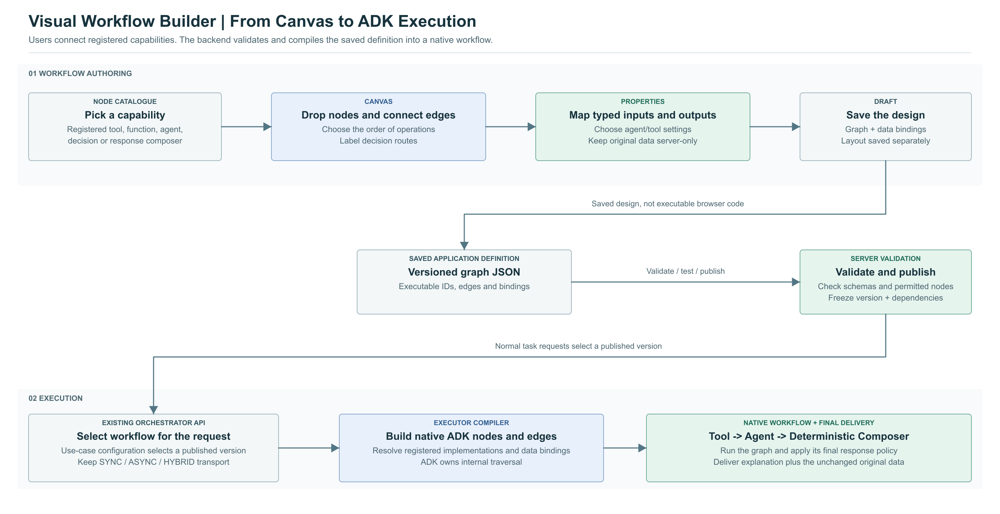

# Workflows Explained: Agent Reasoning, Exact Tool Data, and Drag-and-Drop

**Updated:** 23 October 2026  
**Scope:** Automatic workflows; generic examples inspired by the requested tool-response pattern

## 1. What Exists Today

Based on the flow material supplied for your platform, the Orchestrator already receives requests, validates configuration and identity, creates a plan, saves the runtime, and sends work to the Executor. The Executor constructs the selected agent using the configured libraries and runs it with its tools.

The execution modes decide how work travels:

- **SYNC:** The request waits while the coordinator calls the Executor directly.
- **ASYNC:** Kafka delivers work, and the final result is delivered later.
- **HYBRID:** The API acknowledges early, then a background coordinator calls the Executor directly in the later supplied design.
- **STREAM:** Selected events are delivered as work progresses; the underlying execution mode still applies.

The existing outer plan describes which agent/executable runs next. The upgraded libraries give the application access to ADK 2.x features. Installing those libraries alone does not create a published workflow catalogue, a drag-and-drop editor, or the application models needed to save a user's graph.

Exact current planner/wrapper implementation details still need confirmation in the upgraded branches, which are not available in this workspace.

## 2. How ADK 2.x Workflows Work

A workflow is a set of operations connected in an explicit order. Each operation is a node. Each connection is an edge.

- An **agentic node** uses an agent/model to interpret or write something.
- A **deterministic node** runs fixed application code, such as calling a service or assembling a response.
- A **decision node** checks data and selects a named route.

ADK follows the edges and runs the next eligible node. A function can run before an agent, after an agent, or between two agents. The entire workflow does not have to be model-driven. These are native framework capabilities. [ADK graph workflows](https://adk.dev/graphs/)

The earlier branching example is still a useful pattern, but it is not the main pattern needed for your final-response requirement. That requirement needs both kinds of node in the same successful execution.

## 3. The Requested Mixed Workflow

Consider a request: **"Get the latest report and show the results."**

```text
Request
  -> Fetch tool data                 [deterministic]
  -> Write a short explanation       [agentic]
  -> Assemble explanation + data     [deterministic]
  -> Deliver response
```

The agent might write: "Here are the two results returned for your request."

The tool might have returned this existing block:

```text
ID | Status | Amount
R1 | Open   | 120.00
R2 | Closed | 85.50
```

The deterministic final step copies that original block after the explanation. The model does not need to read, summarize, retype, or recreate the block.


There are two paths in the diagram:

1. **Workflow control and reasoning:** Fetch data, pass small safe facts to the agent, then run the deterministic composition node.
2. **Original data:** Save the tool output outside model-visible events/state and retrieve it at the final delivery boundary.

This is a response-composition contract. It does not depend on the unfinished domain-specific storage feature discussed earlier. It does require a private output-store/response-builder adapter to be implemented or supplied by an existing service.

## 4. Why the Tool Data Must Bypass the Agent

Putting a function after the agent prevents the model from writing the final data block, but does not by itself prevent the model from reading the data earlier.

For example, if an agent calls a tool and the raw tool response is added to the agent's conversation, the model has already received it. Appending the data later does not undo that exposure.

For the initial workflow, use an explicit deterministic tool-call node. It performs the call, stores the original output, and returns only metadata needed for the explanation, such as success status and row count.

If a tool must remain inside an agentic node, use a verified interceptor before its result reaches model-visible history. It must preserve the original output separately and substitute the small model-safe result before persistence and model continuation. This is a separate integration path that needs tests against the upgraded callbacks.

ADK's node output, user-facing messages, and session state serve different purposes. Input schemas and a prompt saying "ignore the table" do not create a data-isolation boundary. [ADK workflow data handling](https://adk.dev/graphs/data-handling/)

An agent that sees only a row count can introduce the report, but cannot legitimately describe patterns or totals that it has not been given. Supply exact permitted aggregates when the narrative needs those facts.

## 5. What "As It Is" Means

Choose the preservation rule explicitly:

| Original tool result | Preservation rule |
|---|---|
| Text, Markdown, CSV, or a pre-rendered table | Keep the original encoded bytes; append the same block without trimming, reformatting, or model rewriting |
| Structured JSON value | Preserve the original value unless a presentation conversion is explicitly requested |
| Already-serialized JSON text with exact formatting required | Preserve the original serialized bytes, including formatting |
| Rows that must become a Markdown table | Use a deterministic renderer; the values remain exact, but this is a format conversion rather than byte-identical copying |

The full response contains a new explanation and separators, so it cannot be byte-identical to the tool output as a whole. The original data section can be byte-identical. HTTP/JSON encoding may escape content on the wire; verify the decoded data block or the selected rendered representation accordingly.

The companion [composition helper](examples/response_composition.py) and [tests](examples/test_response_composition.py) demonstrate exact block preservation, owner-scoped lookup, and checksum verification without a model dependency.

## 6. Where the Final Deterministic Step Runs

Your architecture has two levels:

- The Executor runs the internal workflow.
- The Orchestrator owns the outer task and final client response.

The composition node belongs after the agent in the workflow. It returns a **response manifest**, meaning an explicit description of how to assemble the answer:

```json
{
  "explanation": "Here are the two results returned for your request.",
  "original_output": {
    "key": "<opaque-private-reference>",
    "sha256": "<original-block-checksum>",
    "content_type": "text/plain; charset=utf-8"
  },
  "finalizer": "append_original",
  "requires_final_delivery": true
}
```

This manifest contains a reference, not the original rows. The trusted final response adapter resolves it and appends the original block after the last model-based stage.

For a workflow that is the entire outer plan, configure deterministic final delivery and skip an unnecessary second narrative-generation step. For a mixed outer plan with later agents or synthesis, carry the original reference separately and render the original block only after those stages finish.

Do not expand the original output and then feed the assembled answer into another output-generator model. That would break the intended flow.

The native [mixed workflow example](examples/mixed_response_workflow.py) builds the graph and emits the manifest. The separate finalizer in the helper demonstrates actual assembly. Neither is presented as an already-wired production service.

## 7. How I Suggest Implementing This

### Keep the existing outer plan and transports

The Orchestrator selects an immutable workflow version as one outer plan step. Kafka, direct HTTP, and background hybrid execution continue to carry that executable through their existing adapters.

### Add reusable node implementations

Register functions such as "Fetch Tool Data", "Select Agent Input", and "Append Original Tool Output". Reuse existing configured agents as agentic nodes.

### Compile the saved graph into native ADK

The application validates node IDs, edges, schemas, data bindings, and permissions, then translates the graph into a native ADK `Workflow`. ADK executes its internal nodes. The Orchestrator advances its outer step only when the root workflow finishes.

### Add the final response adapter

Make the shared final response boundary understand the manifest. It resolves the original tool output in the trusted tenant/use-case/run scope, verifies its checksum, and appends it without model processing.

A durable output-store implementation is required for Kafka, restart recovery, and multi-process operation. The included memory store is only a small test/example adapter; it does not provide those guarantees.

### Test the data boundary

Capture actual model requests during integration tests and assert that a marker from the original tool payload is absent. Verify that the same marker is present, unchanged, in the final data section. Also verify that no later synthesis stage receives the expanded payload.

## 8. How Drag-and-Drop Would Work

The editor lets a user describe the graph. It does not execute the graph in the browser.



The interface has three main areas:

| Area | What the user does |
|---|---|
| Node palette | Selects configured agents, registered functions/tools, decision nodes, and response composers |
| Canvas | Drops nodes, connects typed output/input handles, and labels decision routes |
| Properties panel | Chooses an agent/tool, maps input fields, sets allowed policies, and configures the response composition |

For the requested example the user would:

1. Add a Start/request node.
2. Drag **Fetch Tool Data** onto the canvas and choose a permitted tool.
3. Drag **Agent** and choose an existing explanation agent.
4. Map the request question, status, and row count to the agent input.
5. Drag **Append Original Tool Output** after the agent.
6. Map the explanation to its narrative input and the fetch node's private reference to its original-output input.
7. Connect it to the final response/output node.
8. Validate, test with a fixture, and publish a version.

Every run of the published version then follows this graph. The user is not required to write Python for already-registered node capabilities.

## 9. What Is Saved From the Canvas

Save executable data and visual layout separately:

```json
{
  "definition": {
    "workflow_id": "generic.report_response",
    "version": "draft",
    "nodes": [
      {"id": "fetch", "kind": "deterministic", "implementation_ref": "tools.fetch_report.v1"},
      {"id": "explain", "kind": "agentic", "agent_ref": "agents.report_intro.v1"},
      {"id": "compose", "kind": "deterministic", "implementation_ref": "responses.append_original.v1"}
    ],
    "edges": [
      {"source": "fetch", "target": "explain"},
      {"source": "explain", "target": "compose"}
    ],
    "bindings": [
      {"source": "fetch.summary", "target": "explain.input"},
      {"source": "explain.explanation", "target": "compose.explanation"},
      {"source": "fetch.original_ref", "target": "compose.original_ref", "visibility": "server_only"}
    ]
  },
  "ui_layout": {
    "positions": {"fetch": {"x": 100, "y": 200}, "explain": {"x": 450, "y": 200}, "compose": {"x": 800, "y": 200}}
  }
}
```

This is an explanatory excerpt of the proposed application format. The [complete mixed definition](examples/mixed-response-definition.json) includes request normalization and publication/output policies.

An edge means **run this after that**. A binding means **take this value from that output**. They are related, but are not the same contract. A later composer can depend on an earlier fetch node's private result reference even though its direct control predecessor is the explanation agent.

The compiler resolves such bindings into trusted internal context or explicit mapping nodes. It does not expose private payloads to every intermediate node.

## 10. Typed Ports and Validation

The node catalogue declares input/output schemas and permitted visibility:

| Node | Input | Output |
|---|---|---|
| Fetch Tool Data | Validated request/tool parameters | Model-safe summary plus server-only original-output reference |
| Explanation Agent | Question and allowed summary fields | Explanation text |
| Append Original Output | Explanation plus trusted original-output reference | Response manifest |
| Final Delivery Adapter | Manifest plus trusted execution scope | Final client response |

The UI can prevent incompatible connections. The server must repeat all checks before test or publish. A `server_only` port cannot be mapped to an agent prompt, model tool response, or client progress field.

The server also validates reachability, terminal paths, complete route labels, configured tools/agents, owner scope, implementation versions, resource budgets, and output policies. A connected line alone is not proof that the workflow is valid.

## 11. Builder APIs and Backend Responsibilities

The following are suggested new application operations, not existing endpoints:

| Operation | Purpose |
|---|---|
| Get node catalogue and schemas | Populate the palette and property controls from permitted capabilities |
| Create/update workflow draft | Save graph and layout with an optimistic revision |
| Validate draft | Return node/edge/field-specific errors without running it |
| Test draft | Compile and execute a bounded fixture run with node-level results |
| Publish workflow | Pin validated definition and dependency versions |
| Read published versions | Allow use-case configuration to select an exact executable |

These can live in an appropriate configuration/design API surface. Runtime requests continue to use the existing task APIs and select the published workflow through configuration.

New custom Python functions require development and registration. A user can compose their own workflow from available capabilities; drag-and-drop does not automatically create arbitrary new backend behavior.

## 12. Templates, Test Mode, and Versioning

Offer templates such as "Tool -> Agent -> Exact Response", "Classify -> Decision -> Specialist Agent", and "Fetch -> Calculate -> Agent -> Compose".

Test mode should use fixed tool fixtures and a fake/configured model, show each node's status, and preview the final response. Server-only original output is visible only to an authorized test preview, never automatically to the model trace.

For response composition, use supported typed slots or registered templates. A visible pattern such as `explanation + original_tool_output` is resolved by deterministic code; do not evaluate arbitrary template expressions or code from the canvas.

Published versions are immutable. Editing a graph creates a new draft/version. Active runs keep their existing graph and dependencies. Changing only node positions does not change the executable hash.

## 13. Existing ADK Visual Builder

ADK already documents an experimental Visual Builder in ADK Web. It can visually author supported agent components and generates Agent Config YAML and custom-tool Python files. Its documented limitations and generated format must be assessed against this graph/data-binding design. [ADK Visual Builder](https://adk.dev/visual-builder/)

It is useful for a prototype, but it does not by itself establish integration with your tenant configuration, publication/versioning, Kafka/direct transports, private output bindings, or response-composition contract. ADK Web is documented as a development/debugging interface. For an end-user workflow designer, reuse suitable components only after checking those requirements; otherwise add a canvas to the existing application backed by the proposed definition APIs. [ADK Web interface](https://adk.dev/runtime/web-interface/)

## 14. Delivery Order

1. Implement and test the mixed native workflow and deterministic final response adapter.
2. Implement the versioned definition, compiler, and node catalogue needed to express it.
3. Connect it through the existing sync execution path and verify the model/data boundary.
4. Add durable output lookup and verify async/hybrid/recovery behavior.
5. Build the palette, canvas, properties panel, validation, test preview, and publish flow around that proven backend contract.

The complete [architecture document](ADK_2_Workflows.md) retains the broader service-change and execution-mode plan. This guide explains the main mixed workflow and the proposed visual authoring experience.
