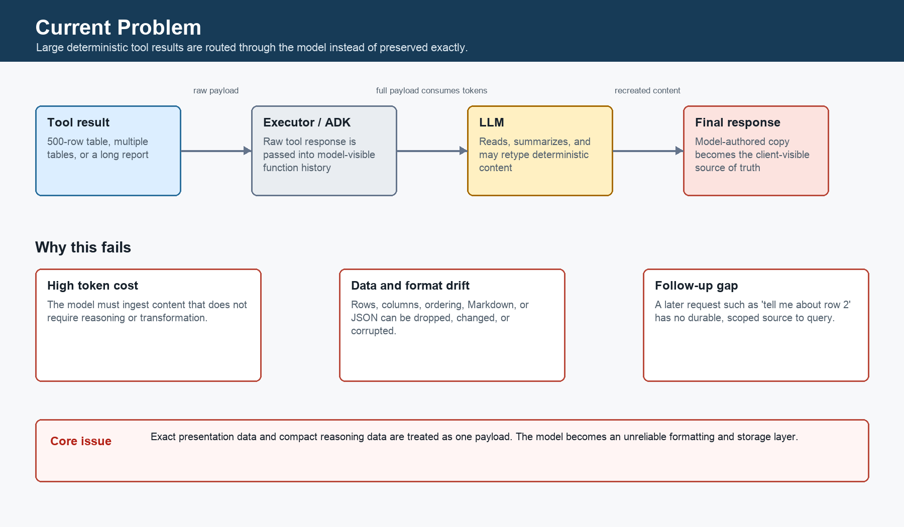
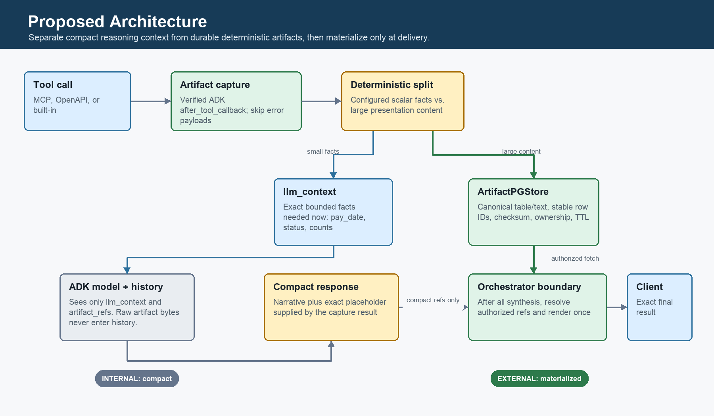
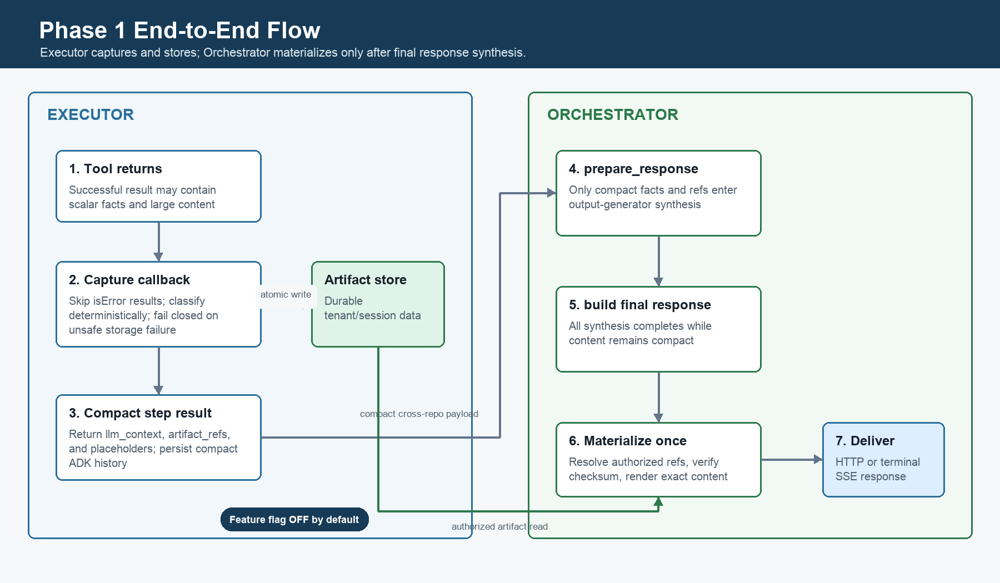
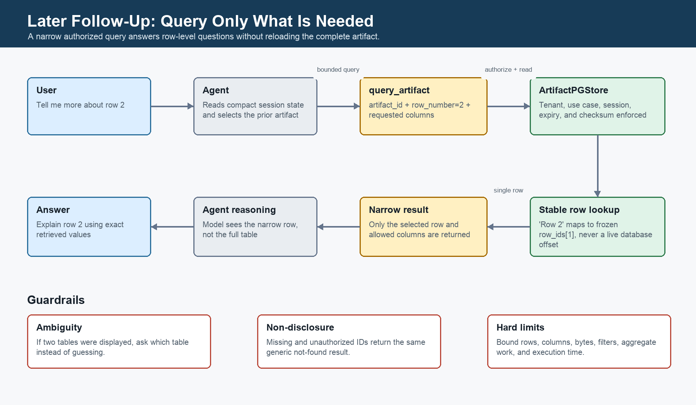
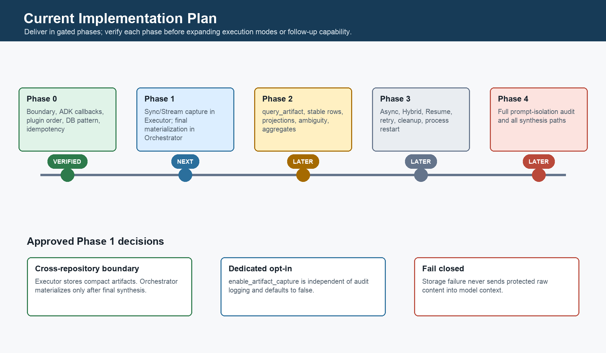

# Deterministic Tool-Result Artifacts for Agent Responses

## Document status

| Item | Status |
| --- | --- |
| Architecture | Proposed and verified against the current Executor, Orchestrator, and Google ADK 2.6.3 code paths |
| Phase 0 | Complete |
| Phase 1 | Approved to begin across both repositories |
| Production enablement | Requires security and data-retention review |
| Feature default | Disabled (`enable_artifact_capture = False`) |

## Executive summary

Some tools return large deterministic payloads such as tables, reports, and structured records. Today those payloads travel through the model context and the model is expected to reproduce them in the final response. This wastes tokens, can corrupt exact data or formatting, and leaves no durable source for later questions such as "tell me more about row 2."

The proposed design separates each successful tool result into:

- `llm_context`: small facts the model needs for reasoning in the current turn.
- `artifact_refs`: references to large deterministic content stored durably outside model context.

The Executor captures and stores artifacts, then sends only compact facts, references, and placeholders through ADK session history and into the Orchestrator. The Orchestrator completes all response synthesis using the compact representation and materializes authorized artifact content exactly once, at the final client-facing response boundary.

This preserves exact tool output without asking the model to copy it, prevents large payloads from re-entering later model context, and creates a safe path for narrow follow-up queries.

## Problem statement

### Current behavior

1. A tool returns a large table, report, or structured payload.
2. The raw result is added to model-visible function history.
3. The model reads the entire result and recreates some or all of it in its answer.
4. The model-authored copy becomes the client-visible result.
5. ADK session history may retain the same large payload for later turns.



### Why this is a problem

| Problem | Impact |
| --- | --- |
| Unnecessary context usage | Large deterministic data consumes model tokens even when no reasoning over the full dataset is needed. |
| Data and format drift | Rows, columns, ordering, Markdown, JSON, and exact values may be omitted or changed when the model retypes the result. |
| Context leakage | Materialized content can be persisted in session history or passed into later synthesis prompts. |
| Weak follow-up support | A later reference such as "row 2" has no stable, durable, session-scoped source. |
| Cross-process durability | Async, Hybrid, and Resume flows cannot rely on in-process memory. |

### Representative use case

A tool returns event `XYZ123`, including a scalar `pay_date` and a 500-row details table.

- The model needs `pay_date` and `status` to answer the current question.
- The complete table must appear exactly in the client response.
- The model does not need all 500 rows in its context.
- A later turn may ask for details about a displayed row.

The intended compact model-visible shape is:

```json
{
  "llm_context": {
    "event_id": "XYZ123",
    "pay_date": "2026-10-15",
    "status": "APPROVED"
  },
  "artifact_refs": [
    {
      "artifact_id": "art_8f2e...",
      "kind": "table",
      "name": "event_details",
      "placeholder": "{{artifact:art_8f2e...}}"
    }
  ]
}
```

The model can answer from `llm_context` and place the artifact token where the exact table should appear. The table itself remains outside model context.

## Proposed solution



### Core design

1. **Capture successful tool results in the Executor.** Add `ArtifactCapturePlugin.after_tool_callback` after `DbLoggerPlugin` in the current plugin order.
2. **Skip error payloads.** Google ADK can invoke `after_tool_callback` after an error has been substituted. The plugin must inspect the MCP `isError` flag and never capture an error response as an artifact.
3. **Classify deterministically.** Split each result into small reasoning facts and large presentation content. Configured `artifact_always_surface_fields` always remain in `llm_context`.
4. **Persist artifacts durably.** Store large content in a tenant-routed Postgres table with ownership, version, checksum, size, row identity, and expiry metadata.
5. **Replace raw content before the next model step.** Return only `llm_context`, `artifact_refs`, and placeholders from the callback. This compact shape is also what ADK persists in session history.
6. **Keep cross-repository step output compact.** The Orchestrator's synthesis path receives compact output only. Large artifact data must not enter `prepare_response()` or any output-generator prompt.
7. **Materialize once at the real external boundary.** After all synthesis branches in `build_execution_response()` complete, resolve authorized references and insert exact artifact content into the final response.
8. **Support narrow follow-ups later.** A `query_artifact` built-in tool can retrieve a bounded row, column projection, filter result, or deterministic aggregate without loading the full artifact into model context.

## Phase 1 end-to-end flow

Phase 0 confirmed that the Executor has no direct end-user route. Its sync, stream, and async outputs are consumed by the Orchestrator. Therefore final materialization in the Executor would be too early and could feed large content into Orchestrator LLM synthesis.

Phase 1 must span both repositories:

- **Executor:** capture, classify, store, and return a compact step result.
- **Orchestrator:** synthesize from compact data, then materialize only the final client response.



## Component responsibilities

| Component | Repository | Responsibility |
| --- | --- | --- |
| `ArtifactCapturePlugin` | Executor | Inspect successful tool results, classify content, persist artifacts, and return the compact replacement result. |
| Artifact classifier | Executor | Produce `llm_context` plus zero or more artifacts using deterministic rules and use-case configuration. |
| `ArtifactPGStore` | Executor/shared data layer | Create and access the tenant-routed artifact table, enforce idempotency, ownership metadata, checksum, and expiry. |
| ADK session history | Executor | Persist only the compact callback replacement, never raw or materialized large content. |
| `prepare_response()` | Orchestrator | Build synthesis context from compact scalar facts and references only. |
| `build_execution_response()` materializer | Orchestrator | Resolve authorized references and render exact content after every synthesis branch completes. |
| `query_artifact` | Executor, later phase | Return bounded, authorized slices or deterministic aggregates for follow-up questions. |

## Verified architecture decisions

### 1. External response boundary

**Decision:** Materialization belongs at `orchestration/service/execution_response_builder.py::build_execution_response()`, after final response synthesis.

**Reason:** The Executor has no direct end-user route. Materializing there would put large content into Orchestrator step output and risk sending it through another LLM.

### 2. Plugin ordering and callback behavior

**Decision:** Use this order:

1. `MaxLlmCallsPlugin`
2. `DbLoggerPlugin`
3. `ArtifactCapturePlugin`
4. `LumenReflectAndRetryToolPlugin`

`DbLoggerPlugin.after_tool_callback` returns `None`, so the new plugin can return the first non-`None` replacement result. Keeping it after `DbLoggerPlugin` preserves current audit behavior. The new plugin must skip any result marked `isError`.

### 3. Dedicated feature flag

**Decision:** Add `enable_artifact_capture`, default `False`, independent of `enable_audit_context_logging`.

**Reason:** The audit flag only controls audit-table column content. It is not an authorization or data-storage policy and must not gate artifact persistence.

Implementation may proceed behind the disabled flag. Enabling it in production requires security and data-retention sign-off.

### 4. Database initialization

**Decision:** Follow the current `RuntimePGStore` lazy initialization pattern: `_init_db()` with `conn.run_sync(Base.metadata.create_all)` on first use.

**Reason:** There is no Alembic or other versioned migration framework in these repositories. The older `PartsPGStore` assumption of an externally provisioned table is not the current pattern.

### 5. Failure policy

**Decision:** Fail closed for capture and storage failures.

- Raw protected content must not fall through into model context.
- Return a bounded, sanitized tool-error shape consistent with existing error handling.
- Log and emit a metric with server-side detail.
- Do not expose artifact data in the error.
- Do not turn a handled artifact failure into an unhandled HTTP 500.

### 6. Idempotency

**Decision:** Build the capture key from `tool_context.invocation_id` plus `tool_context.function_call_id`, with a deterministic sequence suffix when one tool call produces multiple artifacts.

## Storage and isolation model

Each artifact row should include at least:

- Opaque `artifact_id`
- `tenant_coin`, `usecase_id`, and `session_id`
- `invocation_id`, `tool_call_id`, and `tool_name`
- Name, kind, content type, version, and display order
- Row count, size, checksum, canonical data, and stable row IDs
- Authorization scope and source metadata
- Creation and expiry timestamps

Every write and read must use the existing tenant database/schema resolution path. A read is authorized only when tenant, use case, and session ownership match the current runtime context. Missing and unauthorized identifiers must produce the same generic not-found result.

Artifact content is treated as untrusted data. Placeholder materialization is literal replacement, not template or code execution.

## Follow-up query behavior

Phase 2 adds a bounded `query_artifact` tool. Session state records the most recently displayed artifact IDs and display order so a phrase such as "row 2" can resolve to the frozen `row_ids[1]` of the correct artifact version.



The tool must:

- Enforce tenant, use-case, session, expiry, row, column, byte, and execution-time limits.
- Return only the requested data, not the full artifact by default.
- Ask for clarification when multiple displayed tables make a row reference ambiguous.
- Compute dataset-wide aggregates server-side over stored rows rather than asking the model to estimate from a sample.

## Current implementation plan



### Phase 0 - Verification - Complete

- Verified repository branches and clean working trees.
- Confirmed Google ADK 2.6.3 behavior and callback short-circuit semantics.
- Traced Executor and Orchestrator response boundaries.
- Resolved plugin order, database initialization, idempotency, feature flag, and failure policy.
- Established baseline tests: Executor `132 passed, 1 skipped`; Orchestrator `31 passed`.

### Phase 1 - Capture and current-turn materialization - Next

**Executor changes**

- Add `enable_artifact_capture`, `artifact_always_surface_fields`, and retention configuration.
- Add `ArtifactPGStore` and lazy table initialization.
- Add deterministic classifier and `ArtifactCapturePlugin`.
- Skip `isError` payloads and fail closed on unsafe capture/storage failures.
- Insert the plugin after `DbLoggerPlugin`.
- Return compact `llm_context` and `artifact_refs`; keep raw content out of ADK history.

**Orchestrator changes**

- Keep `prepare_response()` synthesis inputs compact.
- Add authorized artifact resolution at the end of `build_execution_response()`.
- Cover all three response-builder branches: multi-step synthesis, multi-step raw last step, and single-step raw first step.
- Materialize before the final HTTP response or terminal SSE result is sent.

**Phase 1 modes**

- Implement and validate Sync and Stream first.
- Keep the feature disabled by default.
- Enable for one approved pilot use case only after security and retention review.

### Phase 2 - Follow-up queries

- Add `query_artifact` with tenant/session authorization.
- Record `last_displayed_artifacts` in session state.
- Support stable row IDs, column projection, filters, and bounded pagination.
- Add exact server-side `sum`, `count`, `min`, and `max` aggregation.

### Phase 3 - Async, Hybrid, and Resume hardening

- Verify artifacts survive process restart and interruption/resume.
- Add retry and duplicate-write tests around the idempotency key.
- Enforce soft expiry immediately and add physical cleanup when scheduled infrastructure is available.

### Phase 4 - Orchestrator and rollout hardening

- Confirm no materialized content enters any synthesis prompt or later model turn.
- Add observability, leak detection, and pilot rollout controls.
- Decide whether AG-UI live text should render placeholders client-side or wait for terminal materialized output.

## Testing strategy

### Phase 1 required tests

- Feature flag off produces byte-compatible existing behavior.
- Scalar-only result produces no artifact.
- One table produces one artifact and one placeholder.
- Multiple tables and multiple tool calls preserve deterministic display order.
- Mixed payload preserves configured scalar facts in `llm_context`.
- `isError` payload is not captured.
- Plugin order preserves current audit logging and replaces only the model-visible result.
- Artifact write is idempotent for the same invocation and function-call ID.
- Tenant, use-case, session, expiry, checksum, size, and row metadata are persisted correctly.
- Raw artifact data never appears in ADK session events.
- Orchestrator synthesis receives compact content only.
- All response-builder branches materialize at the final boundary.
- Final table/report content is byte-identical to the stored canonical representation.
- Capture/storage failure returns a sanitized bounded error and never leaks raw content or causes an unhandled 500.
- Sync HTTP and terminal Stream/SSE responses carry the materialized result.

### Regression suites

Run the existing Executor and Orchestrator suites after each repository change. Keep the Phase 0 baseline counts in the implementation notes and explain any intentional test-count change.

## Acceptance criteria

1. With the flag off, existing behavior and tests remain unchanged.
2. With the flag on, large deterministic tool content is stored durably and excluded from model context and ADK session history.
3. Current-turn scalar questions are answered from compact `llm_context`.
4. Orchestrator synthesis never receives materialized artifact content.
5. The final client response contains the exact artifact content after synthesis completes.
6. Unauthorized, expired, missing, or malformed references do not disclose data.
7. Artifact subsystem failures do not leak raw content and do not create an unhandled 500.
8. Later phases can answer a stable row-level follow-up without reloading the full artifact into model context.

## Risks and remaining gates

| Risk or gate | Mitigation / owner action |
| --- | --- |
| Production storage of new artifact data | Security and data-retention approval before enabling any use case. |
| Cross-repository materializer access | Reuse existing tenant-routed database/service patterns; do not add new infrastructure without approval. |
| Classifier drops a fact needed for current reasoning | Use explicit per-use-case always-surface fields and test real tool contracts. |
| AG-UI live text exposes placeholder tokens | Treat as a documented interim limitation; terminal result remains materialized. Decide client-side rendering separately. |
| Duplicate rows on retries | Enforce the verified invocation/function-call idempotency key and test retries. |
| Multi-part model output | Current extraction reads the first content part; keep placeholders in the supported response field until multi-part handling is addressed. |

## Out of scope for Phase 1

- New cloud object storage or Google ADK `ArtifactService` integration
- Full follow-up query UX and aggregate support
- Physical retention cleanup scheduler
- New client response contract with top-level typed content blocks
- AG-UI placeholder rendering changes
- Broad observability dashboards

## References and attachments

- [Detailed implementation plan](plan.md)
- [Copilot implementation prompt](github-copilot-artifact-implementation-prompt.md)
- [Standalone architecture diagrams](artifact-architecture-diagrams/)

When publishing this page to Confluence, upload the five PNG files as page attachments and replace the relative image links if the importer does not retain them.
