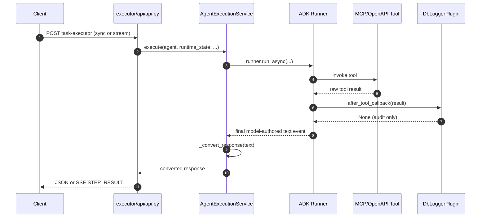
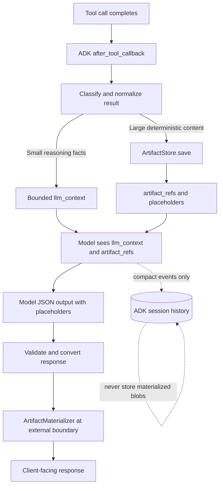
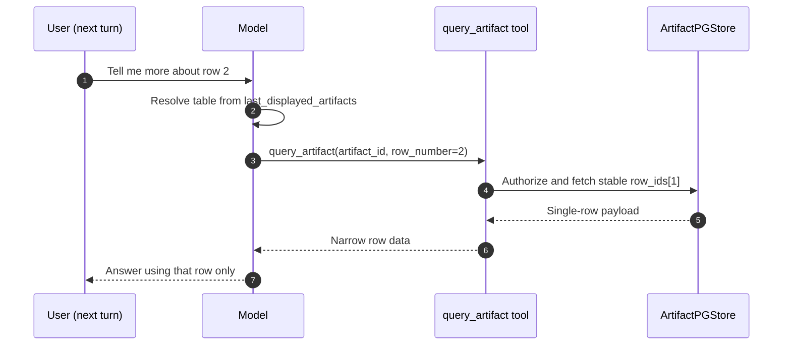

# Deterministic Tool-Result Artifacts: Implementation Plan

> Draft status: screenshot reconstruction complete through section 25. This is an architecture and implementation-planning document, not verified code truth. Every path, API, callback behavior, schema choice, and test command must be checked against the current Executor and Orchestrator repositories before implementation.
>
> Source note: paths, symbols, line references, and Google ADK behavior below were transcribed from the supplied screenshots. The implementation agent must verify every claim against the checked-out Executor and Orchestrator repositories before changing code.

## 1. Executive summary

MCP and OpenAPI tools can return large deterministic content such as tables, long text blocks, and multi-table results. Today, nothing in the Executor prevents the model from reading and reproducing that content in its final JSON response. That is expensive, can corrupt structured data, and makes exact reproduction depend on model behavior.

A simple final-response merge is not sufficient. It may let the system append an untouched table after model generation, but it does not preserve useful access for a later question such as "tell me more about row 2" or "what is the pay date?" Without a durable reference, the entire table must be loaded into model context again or the follow-up cannot be answered.

The recommended design introduces an opt-in, durable, tenant- and session-scoped artifact mechanism owned by the Executor:

1. A Google ADK `after_tool_callback` observes successful tool results and separates them into:
   - `llm_context`: small, exact facts needed for reasoning in the current turn.
   - `artifacts`: large deterministic content stored outside model context.
2. The model sees only bounded `llm_context` plus opaque `artifact_refs`; it does not receive the large artifact bytes.
3. The model places explicit artifact placeholders in its schema-conforming response.
4. At the Executor's outer response boundary, a deterministic materializer replaces those placeholders with the original stored content exactly once.
5. A secure `query_artifact` built-in tool allows later turns to retrieve a narrow row, column, range, or filtered slice without loading the complete artifact into context.
6. Storage reuses the Executor's existing tenant-routed Postgres infrastructure and follows the `PartsPGStore` / `agentic_parts_store` pattern. This plan does not introduce a blob store or a parallel storage lifecycle.

The feature must be additive and disabled by default. Existing agents, response schemas, execution modes, audit behavior, streaming contracts, and Orchestrator flows must remain unchanged unless the use case explicitly enables artifact capture.

## 2. Problem statement

The current code path treats the model-authored final response as the only client-facing source of truth:

- `AgentExecutionService._extract_final_answer` in `executor/service/agent_execution_service.py` reads `event.content.parts[0].text`. Raw tool results are visible to the model but are not retained as reusable deterministic response content.
- If a tool returns a 500-row table, the model must either omit it or copy it into its output. Omission loses data; copying consumes tokens and risks corruption or formatting drift.
- A later request such as "show row 2" has no stable artifact reference and therefore requires resending the entire result through the model.
- `DbLoggerPlugin.after_tool_callback` in `executor/util/db_logger_plugin.py` already observes tool results and may serialize them with `json.dumps(result, default=str)` into `audit_table.tool_response`. That store is an audit trail, not a versioned, session-addressable artifact API, and it may be disabled by `enable_audit_context_logging=False`.
- No general tool-result shaping layer currently exists. The raw MCP envelope flows from the tool invocation into callbacks and error handling, including `AgentExecutionService._raise_on_tool_error`.

The system needs two distinct representations of a successful tool response:

1. A compact internal representation safe for the model and ADK session history.
2. An exact client representation produced only at the final delivery boundary.

Those representations must not be conflated. Materialized artifact data must not leak back into subsequent model prompts, Orchestrator synthesis prompts, ADK session history, runtime snapshots, or Kafka step-to-step payloads.

## 3. Goals and non-goals

### 3.1 Goals

- Keep deterministic, bounded `llm_context` available for same-turn reasoning, including exact scalar facts such as `pay_date`, status, identifiers, and counts.
- Keep large tables, long reports, and other presentation-only content out of LLM token context on both the initial turn and later follow-ups.
- Support exact, opaque placeholders that are materialized once. Inserted artifact content is never recursively scanned for more placeholders.
- Support multiple artifacts from one tool and from multiple tools in one execution.
- Provide a tenant- and session-scoped `query_artifact` capability for follow-up questions using stable row IDs, artifact names, column projections, ranges, and supported filters rather than raw database offsets.
- Make artifact rows durable for Async, Hybrid, and Resume flows. Invocation-scoped storage may be acceptable only for Sync or Stream requests that explicitly do not support later turns.
- Reuse existing authentication, tenant routing, database, and persistence patterns.
- Preserve behavior for every use case that does not opt in.
- Keep implementation changes narrow, additive, and consistent with current repository structure.

### 3.2 Non-goals for the initial implementation

- Model-side aggregation over an entire artifact, such as averaging 5,000 rows from a sampled or truncated context. Full-set aggregation requires a deterministic server-side query operation.
- A rewrite of the Orchestrator `output_generator` or `execution_response_builder.py`. Only a minimal artifact-aware passthrough rule should be considered.
- Vector search, semantic search, or a RAG layer over artifact content. `query_artifact` is a structured accessor.
- A new generic binary artifact platform. Images, PDFs, and existing `PartHolder` use cases remain orthogonal.
- Replacing the existing audit store with the artifact store.
- Adding Hybrid-specific delivery behavior before the base Sync/Stream path is working and verified.

## 4. Current code findings by subsystem

### 4.1 Agent creation and ADK wiring

- `executor/core/factory/agent_factory.py:261-283` dispatches `agent_type` to the existing LLM, sequential, parallel, nested, and loop builders.
- `executor/core/agents/llm_agent_builder.py:39-102` builds the ADK `LlmAgent`.
- Tools are wired through `ToolFactory.create_tools` near the existing builder's tool configuration.
- `output_schema` is built from `agent_config.prompt_text.output_schema` through the existing schema converter.
- An `after_model_callback` already exists for the AgentFlow guardrail.
- `executor/models/agent_mode.py` defines collaboration modes such as `CHAT`, `TASK`, and `SINGLE_TURN`.
- `executor/models/agent_metadata.py` constrains task-mode agents to leaf behavior.
- `PromptText` carries `response_type` and `output_schema` per agent. Artifact behavior should therefore be enabled by use-case metadata, not inferred merely from the presence of a particular agent output schema.

### 4.2 Tool registration and execution

- `executor/core/factory/tool_factory.py:64-114` groups tools by type, including MCP, built-in, and OpenAPI, then delegates to the relevant builders.
- `executor/core/tools/mcp_tool_builder.py:44-57` uses the ADK `McpToolset`, streamable HTTP transport, configured tool filters, and per-call auth/correlation headers.
- There is no general-purpose result adapter between a tool's raw result and the model-visible function response.
- Existing code reads the raw MCP envelope directly in error handling and audit callbacks.

### 4.3 Existing callbacks and plugins

Plugins are assembled in `AgentExecutionService._build_plugins` near the existing `DbLoggerPlugin` and `LumenReflectAndRetryToolPlugin` construction. The screenshot-derived current order is:

1. `MaxLlmCallsPlugin` when configured.
2. `DbLoggerPlugin`.
3. `LumenReflectAndRetryToolPlugin`.

`DbLoggerPlugin` implements user-message, run, agent, model, tool, and error callbacks. Its callbacks currently return `None`; it observes behavior without replacing results. It may write audit records and emit configured Kafka or SSE events.

`CompactionMiddleware` exists but is currently opened with compaction disabled. Large raw tool content left in ADK history is therefore not reliably removed by compaction. Artifact capture must prevent the raw payload from entering history in the first place.

### 4.4 Structured response parsing

The current final-answer flow is approximately:

```python
def _extract_final_answer(self, event, stream, current_answer) -> str:
    if not event.is_final_response() or not event.content:
        return current_answer

    part_text = event.content.parts[0].text if event.content.parts else None
    if part_text is None:
        return current_answer

    final_answer = part_text.strip()
    if stream:
        stream.emit_text_message(text=final_answer)
    return final_answer
```

Important constraints:

- Only `parts[0]` is read. Artifact placeholders must therefore be carried inside the single text part's JSON unless this existing limitation is deliberately changed and tested.
- `_convert_response` parses the model's text as JSON and returns a dict/list when conversion succeeds.
- The natural materialization point is immediately after `_convert_response`, but only at the outermost Executor response boundary.
- The same unmaterialized internal response must remain available for ADK history, runtime state, and step-to-step orchestration.

### 4.5 Tenant-routed persistence

The closest existing pattern is `executor/core/db/parts_pg_store.py`, with a similar implementation in the Orchestrator repository.

The pattern includes:

- A SQLAlchemy model such as `AgentPartsStorePgModel`.
- A tenant-local table, currently `agentic_parts_store` for the parts feature.
- A primary key, an indexed correlation identifier, JSON payload storage, and timestamps.
- A singleton store instance keyed by `(db_name, db_schema)`.
- A shared `PGStore` base that owns the async engine and connection pool.
- Central tenant resolution through `executor/dependencies.py::check_db_name_schema(task_payload)` using environment defaults and use-case metadata overrides.

The artifact store should reuse this resolution and lifecycle exactly. It must not add separate tenant-routing rules.

### 4.6 Runtime, session persistence, and resume

- `executor/core/db/runtime_pg_store.py` persists runtime snapshots including `session_id`, runtime state JSON, and timestamps.
- `executor/core/session/session_manager.py` selects database-backed or in-memory ADK sessions according to current persistence rules.
- Interrupted in-memory sessions serialize session events into interruption state and rehydrate them during resume.
- Artifact references may be present in those events, but durable artifact rows must not depend on the serialized session blob. The artifact data must have its own lifecycle and retention policy.

### 4.7 Execution modes

`ExecutionMode` currently represents `ASYNC`, `SYNC`, and `HYBRID`. Stream is a transport, not a fourth execution mode. The Executor's SSE endpoint can carry events for an existing execution mode without changing `runtime_state.execution_mode`.

The first implementation phase should support the already-built Sync/Stream path. Hybrid-specific durable completion and external delivery integration should remain a later phase.

### 4.8 SSE and streaming

Two independent streaming paths currently exist:

1. **HTTP SSE:** the Executor stream route, streaming models, and SSE utility use an in-process queue of frames. The event sink is passed through execution context and plugins. A terminal `STEP_RESULT` carries the final converted response.
2. **Kafka AG-UI stream:** `AGUIKafkaStreamService` publishes run, tool, text, and state events for UI consumption. It is gated according to execution mode and current configuration.

The current `_extract_final_answer` may emit the model's text before `_convert_response` and artifact materialization. The implementation must make an explicit product decision:

- Either live text events may contain placeholders while the terminal response is fully materialized, or
- final text emission must move behind materialization so every client-facing final event contains the same response.

The second option is semantically cleaner but may touch more shared streaming behavior. Do not select either option without tracing all existing consumers and regression tests.

### 4.9 Authentication and tenant isolation

- Executor API routes use the existing JWT and COIN authorization mechanisms.
- Use-case configuration is keyed by existing use-case and consumer identity fields.
- Database name and schema are resolved through `check_db_name_schema`.
- Artifact capture, lookup, and materialization must require the same resolved tenant, application/use-case identity, user/session scope, and correlation/runtime ownership used by the original execution.
- Missing and unauthorized artifacts should produce the same outward response to prevent existence probing.
- No new `csi_id`-based database routing should be introduced as part of this feature.

### 4.10 Redaction and audit

`DbLoggerPlugin` currently has a binary audit-context gate and no general field-level redaction policy for arbitrary tool payloads. Artifact capture must not silently invent a new security classification system.

Before implementation, decide and document whether the artifact store:

- Is allowed only when the existing audit/data-retention gate permits durable payload storage.
- Requires explicit per-tool allowlisted fields.
- Stores full raw tool results, extracted artifact sections, or normalized artifact values.
- Preserves current raw audit logging or intentionally changes it to compact references.

This decision is a release gate because artifact storage changes the retention and discoverability of tool data.

### 4.11 Orchestrator-side risk

`orchestration/service/execution_response_builder.py::prepare_response` builds an `agent_outputs` prompt context and invokes an output-generation model. The asynchronous Kafka path has a comparable synthesis step, while sync coordination carries step output forward.

If a materialized table is inserted before the Executor's absolute external boundary, it can be copied into:

- A later agent's input.
- The Orchestrator output-generator prompt.
- Kafka step payloads.
- Runtime snapshots or resumed session history.

Therefore, internal step responses must continue to contain compact artifact references. Exact content is materialized only for the response channel that actually leaves the system for the user. The Orchestrator may need a minimal passthrough rule so it preserves artifact placeholders and references without asking another model to rewrite artifact content.

### 4.12 Existing test areas to extend

The screenshots identify the following nearby tests. Confirm exact names and locations before editing:

| Area | Candidate test file |
|---|---|
| DbLogger callbacks | `tests/unit/test_executor_util_db_logger_plugin.py` |
| Agent builders and schema wiring | `tests/unit/test_executor_core_agents.py` |
| Response conversion | `tests/unit/test_executor_service_agent_execution_service_convert.py` |
| Execution and interruption flow | `tests/unit/test_executor_service_agent_execution_service_flow.py` |
| Plugin construction and order | `tests/unit/test_executor_service_agent_execution_service.py` |
| SSE parsing | `tests/unit/test_executor_sse_parser.py` |
| SSE frame contracts | `tests/unit/test_executor_streaming_contracts.py` |
| API dependency wiring | `tests/unit/test_executor_api_dependencies.py` |
| AG-UI Kafka events | `tests/unit/test_executor_service_agui_kafka_stream_service.py` |
| Session state tracking | `tests/unit/test_executor_core_state_tracking_generator.py` |
| Interruption and resume | `tests/unit/test_executor_service_interruption_service.py` |
| Runtime Postgres store | `tests/unit/test_executor_core_db_runtime_pg_store.py` |
| Orchestrator synthesis | `tests/unit/test_execution_response_builder.py` |
| Sync coordination | `tests/unit/test_sync_execution_coordinator.py` |
| Orchestrator SSE client | `tests/unit/test_sync_step_client_stream.py` |
| Environment and feature flags | `tests/unit/test_environment.py` |

## 5. Existing end-to-end flow



**Current gap:** the result observed by `after_tool_callback` is logged and then discarded as reusable content. Only the model-authored representation reaches the client.

## 6. Recommended architecture



Four additive components are proposed inside the Executor:

1. **ArtifactStore**: a tenant-routed Postgres repository and thin service wrapper, modeled on `PartsPGStore`.
2. **ArtifactCapturePlugin**: an ADK `BasePlugin` implementation using `after_tool_callback` to classify a successful result, persist artifact content, and return the compact replacement result seen by the model.
3. **ArtifactMaterializer**: a pure, bounded, single-pass response transformer called only after final response conversion and validation.
4. **`query_artifact` built-in tool**: a structured, authorized accessor for a previously stored artifact. It supports limited row, column, range, filter, and later aggregate operations without exposing storage implementation details.

The design requires an artifact-aware response contract. The model should never invent artifact IDs or raw placeholder syntax from memory; it should select only references supplied in tool context.

## 7. Reasoning projection strategy

For each successful opted-in tool result, `ArtifactCapturePlugin.after_tool_callback` returns a replacement structure such as:

```json
{
  "llm_context": {
    "status": "success",
    "event_id": "XYZ123",
    "pay_date": "2026-10-31",
    "row_count": 47
  },
  "artifact_refs": [
    {
      "artifact_id": "art_...",
      "name": "event_details",
      "kind": "table",
      "placeholder": "{{artifact:art_...}}",
      "columns": ["event_id", "pay_date", "status"],
      "row_count": 47
    }
  ]
}
```

Classification must be deterministic and configurable. Do not ask an LLM to decide which bytes become an artifact.

### 7.1 Presentation-only data

For a large table or report with no field required for immediate reasoning:

- `llm_context` contains status, artifact description, row count, and other bounded metadata only.
- The complete content becomes one or more artifacts.
- The model may place the supplied placeholder into the correct output-schema field.

### 7.2 Reasoning-required scalar data

Small exact facts such as `pay_date`, status, identifiers, totals already returned by the tool, or eligibility flags remain in `llm_context` unchanged. They are not replaced by a model-generated summary.

This is essential for questions such as "get event XYZ123 and tell me the pay date." The model needs the exact `pay_date` in the current turn even if a large detail table is stored separately.

### 7.3 Mixed data

For a response containing status, pagination, and a large table:

- Keep allowlisted scalar facts and bounded pagination metadata in `llm_context`.
- Persist the table as an artifact.
- Expose column names and row-count metadata in the artifact reference.
- Do not include sampled table rows unless the per-tool contract explicitly requires a bounded preview.

### 7.4 Dataset-wide reasoning

Do not derive aggregate answers from a truncated sample. If the user asks for a calculation over the complete artifact, the model should call an authorized deterministic operation such as:

```text
query_artifact(
  artifact_id="art_...",
  aggregate={"operation": "sum", "column": "amount"}
)
```

Initial phases may omit aggregate support, but then the capability must fail explicitly rather than letting the model guess from a partial view.

### 7.5 Configuration scope

Artifact behavior should be use-case scoped in the existing metadata model, matching current configuration patterns. Candidate settings include:

- `enable_tool_result_artifacts`
- `artifact_capture_rules`
- per-tool artifact paths or JSON pointers
- per-tool `llm_context` allowlists
- maximum inline value size
- maximum artifact size
- retention duration
- whether durable follow-up access is enabled

Exact field names must follow the current model naming conventions after code inspection.

## 8. Google ADK callback integration

All callback behavior must be verified against the exact pinned Google ADK version in the repository. The screenshots reference `google-adk==2.6.3`; do not assume that version remains unchanged.

### 8.1 `after_tool_callback` replacement semantics

The referenced ADK API allows `after_tool_callback` to return an optional result dictionary. A non-`None` return value replaces the original function response seen by subsequent ADK processing and by the model.

This is the correct hook for replacing a large raw tool result with compact `llm_context` and `artifact_refs`, provided the following are proven by tests:

- The callback receives the complete successful tool result for MCP, OpenAPI, and built-in tools.
- The replacement is persisted to session history instead of the original raw result.
- Tool errors retain existing retry and error behavior.
- The replacement does not break existing tool response validation.

### 8.2 Plugin ordering and short-circuit behavior

The referenced ADK plugin manager evaluates plugins in list order and returns on the first callback that produces a non-`None` result. This creates a critical ordering constraint.

The screenshot proposes:

1. `MaxLlmCallsPlugin`
2. `DbLoggerPlugin`
3. `ArtifactCapturePlugin`
4. `LumenReflectAndRetryToolPlugin`

That order would preserve raw audit observation because `DbLoggerPlugin.after_tool_callback` returns `None` before artifact capture returns a compact replacement. However, once `ArtifactCapturePlugin` returns non-`None`, later plugins do not receive that callback.

Before implementation, verify whether any later plugin currently relies on `after_tool_callback`. If it does, a standalone plugin that short-circuits is unsafe. Use one of these code-consistent alternatives:

- Integrate capture into the last existing observer that is allowed to return a replacement.
- Reorder plugins only if every skipped callback is irrelevant for successful tool results.
- Add an explicit composite callback/plugin that invokes required observers and returns one final replacement.

Do not assume that a later plugin will see either the original result or the replacement after an earlier plugin returns non-`None`.

### 8.3 Session history versus client-facing output

The referenced ADK runner uses one output event for both session persistence and caller yield. There is no clean callback hook in that version for persisting a compact event while simultaneously yielding a separately materialized event.

Therefore, responsibilities are deliberately separated:

- `after_tool_callback` keeps raw artifact bytes out of model-visible function responses and ADK session history.
- `ArtifactMaterializer` runs after the ADK event loop has completed and only at the Executor's external response boundary.

This ensures a later model turn sees compact references rather than the previously materialized table.

### 8.4 Capture failures and `on_tool_error_callback`

`on_tool_error_callback` handles failures from the tool invocation itself. It is not the right hook for a failure inside artifact classification or persistence.

Capture failures must be handled directly inside `after_tool_callback` with an explicit policy. The policy is a design gate because the tradeoff is real:

- Returning the raw result preserves functional output but can reintroduce token growth, sensitive-data retention, and corruption risk. This is fail-open for artifact isolation.
- Returning an error prevents leakage and inconsistent history but fails a tool call that otherwise succeeded. This is fail-closed.
- Returning only bounded context without a persisted artifact avoids raw leakage but loses deterministic content.

Select the policy per deployment and data class. Do not label raw-result fallback as fail-closed.

### 8.5 Hooks explicitly not used for materialization

- `after_agent_callback` is too early and still produces content that participates in internal ADK processing.
- `on_event_callback` cannot safely create separate persisted and yielded representations when the same event object is used for both.
- `after_model_callback` may validate placeholder usage, but it must not fetch and insert artifact bytes.

Final artifact materialization belongs at the Executor response boundary, outside ADK callbacks.

### 8.6 ADK `ArtifactService` evaluation

The screenshots identify ADK artifact service implementations for memory, filesystem, and GCS, but recommend against using them for this feature because:

1. They do not directly follow the existing `(db_name, db_schema)` tenant-routing model.
2. GCS would add storage, IAM, network, and operational dependencies.
3. The referenced ADK application wiring does not expose an already-integrated artifact service in the current Executor lifecycle.
4. A custom ADK backend would duplicate lifecycle, authorization, and isolation work already solved by the Executor's `PGStore` family.

The recommended choice is an Executor-owned Postgres artifact table following the existing tenant-routed store pattern. Revisit this decision only if the checked-out ADK version and deployment infrastructure now provide an approved tenant-aware artifact service.

## 9. Configuration, storage, and reference contracts

### 9.1 Per-use-case opt-in configuration

Extend the existing `Metadata` model in `executor/models/agentic_usecase_config.py`, alongside current use-case flags:

```python
class Metadata(BaseModel):
    # Existing fields remain unchanged.

    enable_artifact_capture: bool = Field(
        default=False,
        description=(
            "When true, capture configured large or tabular tool results as "
            "durable artifacts instead of passing the full content through "
            "model context."
        ),
    )
    artifact_always_surface_fields: Optional[List[str]] = Field(
        default=None,
        description=(
            "Tool-result field names, such as pay_date or status, that must "
            "always be copied verbatim into llm_context."
        ),
    )
    artifact_retention_hours: int = Field(
        default=72,
        description="Retention period for durable tool-result artifacts.",
    )
```

Resolve these fields through the existing `AgenticUsecaseConfigManager.get_use_case(usecase_id, consumer_coin)` path. Do not add another configuration lookup or I/O mechanism.

Before coding, validate the configuration shape and decide whether `artifact_always_surface_fields` is sufficiently precise. A flat use-case-wide list can collide across tools with different schemas; a per-tool mapping is safer when names or meanings overlap.

### 9.2 Artifact storage table

Add `executor/core/db/artifact_pg_store.py`, following the established `PartsPGStore` lifecycle and tenant-scoped singleton pattern. The following is a proposed logical schema, not copy-ready migration code:

```python
class AgenticArtifactStorePgModel(Base):
    __tablename__ = "agentic_artifact_store"
    __table_args__ = {"schema": schema}

    artifact_id = Column(String(64), primary_key=True)
    tenant_coin = Column(String(255), nullable=False, index=True)
    usecase_id = Column(String(255), nullable=False, index=True)
    session_id = Column(String(255), nullable=False, index=True)
    invocation_id = Column(String(255), nullable=False)
    runtime_id = Column(String(36), nullable=True)
    tool_call_id = Column(String(255), nullable=False)
    tool_name = Column(String(255), nullable=False)

    name = Column(String(255), nullable=False)
    kind = Column(String(32), nullable=False)  # table, text, report
    content_type = Column(
        String(128), nullable=False, default="application/json"
    )
    version = Column(Integer, nullable=False, default=1)
    display_order = Column(Integer, nullable=False, default=0)
    row_count = Column(Integer, nullable=True)
    size_bytes = Column(Integer, nullable=False)
    checksum = Column(String(64), nullable=False)

    data = Column(JSON, nullable=False)
    row_ids = Column(JSON, nullable=True)
    rendering_policy = Column(
        String(32), nullable=False, default="markdown_table"
    )
    authz_scope = Column(JSON, nullable=False)
    source_metadata = Column(JSON, nullable=True)

    created_at = Column(TIMESTAMP, server_default=func.now())
    expires_at = Column(TIMESTAMP, nullable=False, index=True)
```

Storage requirements:

- `artifact_id` is opaque and non-sequential, for example `art_` plus a UUID.
- `data` stores canonical structured content. Rendering is a separate deterministic concern.
- `checksum` is computed over canonical bytes and supports integrity checks, not authorization.
- `row_ids` freezes stable row identity and display order at capture time.
- `version` makes later replacement or retry behavior explicit.
- `expires_at` is indexed for cleanup and is checked on every read even if physical cleanup has not run.
- Ownership columns are explicit and independently checked on every read.
- `authz_scope` contains only the minimal existing user/application identity needed by current authorization rules.

Expose the store through the existing dependency pattern, for example `get_artifact_store(db_name, db_schema)`, and reuse `check_db_name_schema(task_payload)` verbatim.

### 9.3 Storage requirements by execution mode

| Mode | Minimum storage requirement |
|---|---|
| Sync with no follow-up surface | Invocation-scoped storage could work in theory. |
| Stream | Same theoretical allowance as Sync because one SSE connection is one invocation. |
| Async | Durable storage is required because the Kafka worker may run in another process. |
| Hybrid | Durable storage is required for the same reason as Async. |
| Resume | Durable storage is required because the process may restart between pause and resume. |
| Any continuing conversational session | Durable storage is required regardless of transport. |

**Implementation decision:** Phase 1 always writes artifacts durably. The Executor cannot reliably know at capture time that a Sync or Stream result will never receive a follow-up turn, and the existing `PartsPGStore` pattern already provides durable storage. Retention controls cost and cleanup without adding a second in-memory implementation.

### 9.4 Artifact reference and placeholder contract

The model-visible replacement returned by `ArtifactCapturePlugin.after_tool_callback` has this shape:

```json
{
  "llm_context": {
    "event_id": "XYZ123",
    "pay_date": "2026-10-15",
    "status": "APPROVED"
  },
  "artifact_refs": [
    {
      "artifact_id": "art_8f2e...",
      "kind": "table",
      "name": "event_details",
      "placeholder": "{{artifact:art_8f2e...}}"
    }
  ]
}
```

The agent is instructed through the existing system-prompt/output-schema mechanism to emit only a supplied placeholder, for example:

```json
{
  "answer": "The pay date is October 15, 2026.\n\n{{artifact:art_8f2e...}}"
}
```

Contract rules:

- The model must not invent an artifact ID or synthesize placeholder text.
- Placeholder syntax is exact and opaque: `{{artifact:<artifact_id>}}`.
- Only references issued during the current invocation may be materialized in that invocation's response.
- Artifact metadata available to the model must be bounded and must not contain the artifact payload.
- A placeholder may appear more than once, but materialization is literal, single-pass, and non-recursive.

## 10. Current-turn answering behavior

1. The tool executes normally.
2. `ArtifactCapturePlugin.after_tool_callback` deterministically classifies the result, writes artifact rows durably, and returns compact `llm_context` plus `artifact_refs`.
3. The replacement is what the model sees and what ADK persists in session history. Raw captured content reaches neither.
4. The model answers scalar questions from exact values in `llm_context` and includes supplied placeholders where complete deterministic content should appear.
5. `_convert_response` parses the model's JSON using the existing behavior.
6. `ArtifactMaterializer.materialize(converted, artifact_refs)` runs after conversion and before the external response leaves the Executor.
7. The HTTP Sync body or terminal SSE `STEP_RESULT` carries the materialized result.

The source plan accepts an interim AG-UI behavior in which `_extract_final_answer` emits raw placeholder-containing live text before materialization. This is permitted only if it is documented as a transport limitation, tested, and approved by every live-stream consumer. The terminal response must still be materialized. Moving final text emission after materialization remains the cleaner future behavior.

## 11. Follow-up artifact queries



Add a built-in tool with a bounded structured interface similar to:

```python
query_artifact(
    artifact_id=None,
    table_name=None,
    row_number=None,
    row_id=None,
    columns=None,
    filters=None,
    aggregate=None,
)
```

Register it through `executor/core/tools/built_in_tool_builder.py` using the existing built-in tool pattern.

### 11.1 Session addressing

At successful materialization, update compact ADK session state with references only:

```python
state["last_displayed_artifacts"] = [
    {
        "artifact_id": "art_...",
        "name": "event_details",
        "display_order": 0,
    }
]
```

Resolution rules:

- If exactly one artifact was displayed most recently, "row 2" resolves to its frozen `row_ids[1]`.
- If multiple tables were displayed and the reference is ambiguous, return a structured ambiguity result so the model asks which table. Do not guess.
- "Row 2" refers to the captured artifact version and display order, never a live SQL `OFFSET 2`.
- Artifact name, explicit artifact ID, and stable row ID take precedence over conversational ordinal resolution.
- Reads require the same tenant, use case, and session ownership as capture.
- Missing and unauthorized IDs produce the same generic not-found response.
- Every query is bounded by configured row, column, response-byte, and execution-time limits.

## 12. Response materialization and validation

Conceptual API:

```python
ArtifactMaterializer.materialize(
    response: dict,
    artifact_refs: list[dict],
) -> dict
```

Materialization rules:

1. Validate the model-authored response against the agent's ordinary output schema before materialization.
2. Inspect only schema-approved text-bearing fields rather than performing unrestricted object-tree substitution.
3. Find placeholders with one bounded, non-greedy pass.
4. Resolve each token only against references issued in the current invocation.
5. For an unknown, expired, wrong-type, foreign, or stale reference, leave the token unexpanded and emit a diagnostic metric. Never guess or fetch an arbitrary ID.
6. Replace repeated valid references independently and idempotently.
7. Treat artifact data as untrusted literal content. Never use `eval`, string templates, or executable interpolation.
8. Validate the result after substitution against an explicit materialized-response schema.
9. Keep unreferenced artifacts until TTL expiry because they may be queried in a later turn.

The materialized schema must be decided before implementation. If `rendering_policy=markdown_table`, substitution can remain a string and preserve a string field's schema. If a placeholder is replaced by an object or array, the output schema must explicitly permit that type; a vague "relaxed schema" is not sufficient validation.

## 13. Internal history versus client-facing response

- **ADK session representation:** compact `llm_context` plus `artifact_refs`, exactly as returned by the capture callback.
- **Direct client representation:** materialized only after the ADK run loop, outside persisted ADK events.
- **Orchestrator representation:** must stay compact until the Orchestrator has finished every model-based synthesis step.

### 13.1 Required boundary decision

The screenshots propose materializing at the end of Executor `execute()` and then filtering known large keys from `step.output` before the Orchestrator builds its synthesis prompt. That works only when materialized artifacts occupy separate, known response fields.

It does **not** safely work when an inline placeholder is embedded inside `answer`; the narrative and table become one string, so excluding a table key cannot remove the materialized bytes without also losing the narrative.

Before Phase 1 is implemented, choose one structurally sound contract:

1. Direct Executor clients receive materialized output, while Executor-to-Orchestrator internal calls carry the compact response and refs; the Orchestrator materializes only at its final client boundary.
2. Materialized artifacts live in a separate typed `artifacts`/`tables` response field that the Orchestrator can omit from synthesis prompts and pass through unchanged.
3. The Orchestrator receives both internal and external representations through an explicit envelope and never infers large content by heuristics.

Content-based filtering of "known large keys" may be used only as a temporary compatibility measure when schemas guarantee separate fields. It is not sufficient for arbitrary inline placeholders.

## 14. Security and tenant isolation

Every artifact capture, materialization, and query must:

1. Resolve `(db_name, db_schema)` with the same `check_db_name_schema(task_payload)` used by existing tenant-routed stores.
2. Run inside an already authenticated request using current JWT/COIN authorization.
3. Validate `tenant_coin`, `usecase_id`, and `session_id` against the current runtime state on every read.
4. Return an indistinguishable generic not-found result for missing and unauthorized artifacts.
5. Enforce hard limits for returned rows, requested columns, response bytes, artifact bytes, and execution time.
6. Apply the approved audit and data-retention policy before storing raw artifact data.
7. Record audit metadata through the existing audit mechanism without creating a second audit pipeline.
8. Use literal deterministic rendering so artifact content cannot inject template or control syntax.
9. Never expose database names, schema names, internal row keys, authorization scope, or signed storage details to the model.

The source screenshots tie artifact persistence to `enable_audit_context_logging`. That coupling requires security-owner approval: disabling audit logging does not necessarily mean tool data may not be stored for product functionality. Prefer an explicit artifact-retention/data-classification policy if the current flag's semantics do not cover durable product storage.

## 15. Behavior by execution mode

| Mode | Capture | Materialization point | Follow-up support |
|---|---|---|---|
| Sync | Same callback path; durable write. | Direct client boundary after execution. | Supported when the caller continues the same session. |
| Stream | Same callback path. Live intermediate text may temporarily contain placeholders. | Before terminal `STEP_RESULT`. | Same as Sync. |
| Async | Same callback path in the worker; durability is mandatory. | Before the final Kafka delivery payload is published. | Supported across process restarts. |
| Hybrid | Same durable capture as Async. | At each true external delivery boundary, without duplicating the stored artifact. | Same as Async. |
| Resume | Existing artifacts remain; resumed tool calls may capture new artifacts. | At the resumed invocation's final external boundary. | Pre-interruption artifacts remain queryable until expiry. |

Materialization must happen once per delivery representation, not once per internal hop. Kafka, webhook, HTTP, and SSE are delivery channels; they must not become independent sources of truth or create duplicate artifact rows.

## 16. Repository-by-repository file impact

### 16.1 Executor repository

| File | Intended change |
|---|---|
| `executor/models/agentic_usecase_config.py` | Add opt-in configuration fields to existing metadata. |
| `executor/core/db/artifact_pg_store.py` | New tenant-routed artifact repository modeled on `PartsPGStore`. |
| `executor/core/plugins/artifact_capture_plugin.py` | New ADK callback plugin. |
| `executor/util/artifact_classifier.py` | New deterministic classification helper, separate for unit testing. |
| `executor/util/artifact_materializer.py` | New bounded materialization helper. |
| `executor/core/tools/built_in_tool_builder.py` | Register `query_artifact` using current built-in patterns. |
| `executor/core/tools/query_artifact_tool.py` | New bounded query and authorization implementation. |
| `executor/service/agent_execution_service.py` | Construct capture integration and invoke materialization at the approved boundary. |
| `executor/dependencies.py` | Expose the artifact store through the established dependency-accessor pattern, if required. |
| Database migration location used by this repo | Add the tenant-schema artifact table and indexes. |

Proposed new focused tests:

- `tests/unit/test_executor_core_db_artifact_pg_store.py`
- `tests/unit/test_executor_core_plugins_artifact_capture.py`
- `tests/unit/test_executor_util_artifact_classifier.py`
- `tests/unit/test_executor_util_artifact_materializer.py`
- `tests/unit/test_executor_core_tools_query_artifact.py`

Extend existing service-flow tests for plugin construction, callback ordering, session history, conversion, materialization, and feature-flag behavior.

### 16.2 Orchestrator repository

The exact change depends on the boundary decision in section 13:

| File | Intended change |
|---|---|
| `orchestration/service/execution_response_builder.py` | Ensure large artifact content never enters output-generator prompt context; pass deterministic content through unchanged. |
| `orchestration/service/message_processing_service.py` | Mirror the same behavior in the asynchronous synthesis path. |
| `tests/unit/test_execution_response_builder.py` | Prove compact prompt input and exact final passthrough. |

Do not change the Executor-to-Orchestrator contract merely to fit the first implementation idea. First identify the existing internal/external response boundary, then make the smallest contract-safe change.

## 17. Step-by-step implementation phases

### Phase 0: Verify contracts and settle release gates

1. Confirm the pinned ADK callback signatures, plugin short-circuit behavior, and session persistence sequence from installed source and tests.
2. Confirm the actual Executor-to-Orchestrator call and response boundaries for Sync, Stream, Async, Hybrid, and Resume.
3. Choose the internal-versus-external representation from section 13.
4. Approve data classification, persistence authorization, retention, maximum size, and storage-failure policy.
5. Define per-tool extraction rules for the pilot use case, including exact always-surface scalar fields.

### Phase 1: Capture and current-turn materialization for Sync/Stream

1. Add metadata fields and validation.
2. Add `ArtifactPGStore` and the migration.
3. Add deterministic classification and canonicalization.
4. Add `ArtifactCapturePlugin` or the verified equivalent composite callback.
5. Wire callbacks in an order proven by tests not to skip required plugin behavior.
6. Add the materializer at the approved external boundary.
7. Keep the feature disabled by default and enable one pilot use case.

### Phase 2: Follow-up query and session addressing

1. Add `query_artifact` with authorization, row, column, range, and filter limits.
2. Add `last_displayed_artifacts` session bookkeeping.
3. Add deterministic aggregate operations over full stored data where required.

### Phase 3: Async, Hybrid, and Resume hardening

1. Verify durability across process boundaries and restart.
2. Verify one source-of-truth artifact across Kafka, webhook, HTTP, and SSE deliveries.
3. Add Resume, retry, disconnect, cancellation, and idempotency tests.
4. Add expiry enforcement and cleanup using the repository's existing job pattern.

### Phase 4: Orchestrator prompt-isolation guard

1. Implement the section 13 boundary contract in both synchronous and asynchronous synthesis paths.
2. Prove artifact bytes never enter an Orchestrator LLM prompt.
3. Prove deterministic content remains exact in the final response.

### Phase 5: Optional follow-up work

- AG-UI placeholder rendering or final-text emission redesign.
- Operational dashboards.
- Larger artifact externalization if approved size limits require it.
- Rich typed client content blocks after a versioned contract change.

## 18. Tests and validation for every phase

### 18.1 Phase 1

- Feature flag off: existing response is byte-for-byte and behaviorally unchanged.
- No artifacts: classifier returns empty refs and normal flow remains unchanged.
- One table: one artifact is stored and materialized exactly.
- Multiple tables from one call: stable order and separate references.
- Tables from multiple calls: ordering follows tool-call order.
- Large non-tabular text: stored and rendered according to policy.
- Exact scalar needed this turn, such as `pay_date`, remains in `llm_context` and is answered correctly.
- Required scalar absent from configured projection: produce an explicit classification-gap signal; do not silently guess.
- Validate model response before materialization and the materialized shape afterward.
- Repeated placeholders produce identical deterministic content.
- Unknown, unauthorized, expired, stale, and wrong-type references remain unexpanded and are logged.
- Oversized artifacts create no partial row and produce an explicit bounded marker.
- Capture storage failure follows the approved policy for exactly that tool call without corrupting other calls.
- Materialization failure does not crash the complete response.
- Callback-order tests prove which plugin sees raw data, which callbacks are skipped, and what reaches the model.
- Session inspection proves raw artifact data is absent from persisted ADK events.
- A second turn proves materialized output did not re-enter model history.
- Existing JSON, streaming, parser, audit, interruption, and API tests continue to pass with the flag off.

### 18.2 Phase 2

- Follow-up by artifact name.
- Follow-up by stable row ID.
- Conversational "row 2" resolution through `last_displayed_artifacts`.
- Ambiguous row reference across multiple displayed tables results in clarification.
- Column projection and bounded filters return only requested fields.
- Full-set aggregate operations return exact values, not sampled approximations.
- Cross-tenant and cross-session guessed IDs produce byte-identical generic not-found results.

### 18.3 Phase 3

- Artifacts captured before interruption remain queryable after process restart and Resume.
- Disconnect or cancellation does not roll back an already committed artifact unexpectedly.
- Retried tool calls use a verified idempotency key or documented bounded-version behavior.
- Expired artifacts are unreadable before physical cleanup and are later deleted without touching active runtime state.
- Async and Hybrid final deliveries use the same stored content and do not duplicate records per channel.

### 18.4 Phase 4

- Orchestrator synthesis prompts contain compact narrative/scalars and refs, never materialized artifact bytes.
- Sync and Async Orchestrator paths behave consistently.
- Existing Orchestrator tests remain unchanged for non-opted-in use cases.
- Final deterministic content remains byte-identical after any Orchestrator synthesis step.

### 18.5 Validation sequence for each implementation step

For every phase:

1. Add or update the smallest focused unit test first.
2. Implement only the required production lines.
3. Run the focused test file.
4. Run adjacent subsystem tests.
5. Run formatting, lint, type, and schema/migration checks already defined by the repository.
6. Run the complete affected repository suite before moving to the next phase.
7. Run cross-repository contract tests before enabling the feature flag anywhere.

Do not suppress or broadly rewrite unrelated failing tests. Record pre-existing failures separately and prove they are unrelated.

## 19. Failure and recovery behavior

- **Capture storage failure:** the screenshots propose passing the original raw result to the model and continuing. This is availability-first and fail-open for artifact isolation, even if it avoids data loss. It may be used only if the use case's data policy permits raw model exposure. Otherwise return a bounded tool error or compact failure response.
- **Invalid materialization reference:** leave the literal placeholder, emit a diagnostic, and return the remaining response unless the client contract explicitly requires hard failure.
- **Artifact authorization failure:** return a generic structured not-found result; log full detail server-side only.
- **Oversized artifact:** reject before committing a partial artifact. Return bounded metadata such as `truncated=true` or `row_count_limit_exceeded=true` only if that status is truthful.
- **Expired artifact:** treat as not found at read time, regardless of whether physical cleanup has completed.
- **Partial multi-artifact capture:** either commit all artifacts for one tool result atomically or return no refs for uncommitted items. Never issue a placeholder for content that was not durably stored.
- **Retry:** use a verified idempotency key and unique constraint or a documented versioning rule. Unbounded duplicate rows are not acceptable.
- **Checksum mismatch:** do not materialize or return the content. Emit a high-severity integrity diagnostic.

## 20. Observability and metrics

Reuse the repository's existing observability mechanism. Candidate counters and histograms include:

- `artifact_capture_success`
- `artifact_capture_failed`
- `artifact_classified_llm_context_only`
- `artifact_classified_mixed`
- `artifact_classified_presentation_only`
- `artifact_materialize_success`
- `artifact_materialize_missing_reference`
- `artifact_materialize_expired_reference`
- `artifact_materialize_integrity_failure`
- `query_artifact_success`
- `query_artifact_unauthorized`
- `query_artifact_ambiguous_row_reference`
- `artifact_retention_cleanup_count`
- Artifact bytes stored and materialized
- Raw bytes avoided from model context
- Query rows returned and query latency

Metrics must contain identifiers suitable for aggregation, not user payloads or artifact data.

## 21. Backward compatibility and rollout

- `enable_artifact_capture=False` by default produces no behavior or contract change.
- Roll out through shadow classification, then a single canary use case, then controlled opt-in expansion.
- Shadow mode may classify and measure but must not store sensitive content or alter the model-visible result unless that behavior is explicitly approved.
- Existing endpoint and task payload contracts remain unchanged in the first phase.
- The AG-UI live placeholder behavior is an accepted interim limitation only after consumer approval; terminal responses remain materialized.
- Database migrations must be backward compatible and deploy before feature enablement.
- Rollback is the configuration flag; stored rows expire normally and must not require emergency deletion to disable runtime behavior.

## 22. Alternatives considered

1. **ADK `ArtifactService`:** rejected for the current design because it does not match existing tenant routing and may introduce new infrastructure and lifecycle wiring.
2. **Top-level `artifacts` or `tables` response map:** clearer and more REST-friendly, but changes client contracts. This is the strongest long-term option and may be required to solve the Orchestrator boundary cleanly.
3. **Typed content blocks:** also structurally clean, but similarly requires a versioned response-contract change.
4. **In-memory-only Sync/Stream storage:** rejected because future follow-up cannot be predicted safely and two storage paths add complexity.
5. **Add capture to `DbLoggerPlugin`:** rejected because audit/stream logging and product artifact storage are separate responsibilities.
6. **Put the complete tool result in model context and rely on compaction:** rejected because it does not reduce current-turn token use and compaction is not a deterministic exact-content mechanism.
7. **Let the model summarize all artifacts:** rejected because summaries cannot preserve arbitrary exact values or support reliable row-level follow-up.

## 23. Risks and open questions

1. **Multi-part final responses:** `_extract_final_answer` reads only `parts[0]`. Confirm that all relevant model responses remain single-part or fix this separately with regression tests.
2. **AG-UI placeholder exposure:** requires a product decision with the UI-consuming team.
3. **Orchestrator boundary:** heuristic filtering cannot safely remove a table embedded in an `answer` string. Section 13 must be resolved structurally before rollout.
4. **Retry deduplication:** verify which stable invocation and tool-call identifiers survive client, Orchestrator, Kafka, and Resume retries before defining a unique key.
5. **Branch discrepancy:** if an older structured-output merge implementation returns, reconcile it with this mechanism rather than running both.
6. **Output-schema compatibility:** replacing a string placeholder with an object or array may invalidate the advertised schema. Rendering and response typing must be explicit.
7. **Data policy:** audit logging permission may not be the correct authorization for durable artifact storage.
8. **Database pressure:** large JSON rows, indexes, cleanup, and per-tenant connection pools need load testing.
9. **Concurrent tools:** display order and session-state updates must remain deterministic under parallel agent/tool execution.
10. **Tool-specific semantics:** generic heuristics cannot know every business-critical scalar. The pilot needs explicit extraction rules and a safe behavior for unknown schemas.

## 24. Recommended defaults

- `enable_artifact_capture: false`
- `artifact_retention_hours: 72`
- Maximum rows returned by `query_artifact`: 50, subject to confirmation against current conventions
- Maximum artifact bytes: align with approved existing wire and persistence limits; do not invent a new value without load and security review
- Placeholder rendering: string-only Markdown/plain text in Phase 1 unless the output schema explicitly supports structured insertion
- Storage: durable Postgres for all modes
- Materialization: single-pass and external-boundary only
- Authorization: tenant + use case + session ownership, with generic not-found on mismatch
- Plugin/callback order: retain raw audit observation only if approved, then capture; verify every later callback affected by ADK short-circuiting

## 25. Acceptance criteria

1. With the feature disabled, existing behavior and tests are unchanged.
2. With the feature enabled, a tool-produced table appears exactly in the final client-facing response without the full table entering model context or ADK session history.
3. A same-turn scalar question such as pay date is answered from exact bounded `llm_context` without requiring the full artifact.
4. A later "row 2" question resolves to the correct frozen row through `query_artifact` without loading the complete artifact into model context.
5. Multiple artifacts can be referenced, ordered, materialized, and queried independently.
6. Unknown, expired, unauthorized, malformed, and oversized artifact cases follow the documented recovery policy without cross-tenant disclosure or corrupt partial data.
7. Artifact content never reaches an Orchestrator LLM synthesis prompt.
8. Sync, Stream, Async, Hybrid, and Resume use one durable artifact source of truth and materialize only at true delivery boundaries.
9. Focused tests, adjacent subsystem tests, repository checks, full suites, and cross-repository contract tests pass for every completed phase.
10. The implementation changes only necessary files and lines, follows existing patterns, and introduces no unrelated refactoring.